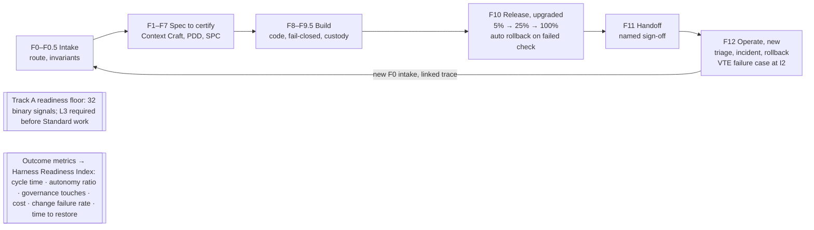

# ARK Harness Upgrade PDD: Readiness, Outcomes and the Closed Loop

13 October 2026 · OLUSEYE AMUSA

## Part 0 — Title and contents

This upgrade gives the ARK Harness what the Factory comparison found missing: a readiness score for the ground each project stands on, one organisation-level metric, outcome measures, a stage after handoff, safe releases and deployment choices. Security remediation comes first, because without it the Harness cannot clear its own new Level 3 floor. Human approval gates stay exactly where they are.

| Field              | Value                                                                                                                         |
|--------------------|-------------------------------------------------------------------------------------------------------------------------------|
| Document           | ARK Harness Upgrade: Readiness, Outcomes and the Closed Loop, PromptWare Design Document v1.0                                 |
| Production ID      | JNGL-ARKH-PDD-RDY-2026-001 (checked only against IDs visible in project documents)                                            |
| Standard           | ATLAS 360 PLAN v4.0.1, 12-Part PDD                                                                                            |
| Amends             | XVL v1.1 (JNGL-ARKH-PDD-XVL-2026-001); COMMAND DECK MAX v1.0 (JNGL-PDD-CMDDECKMAX-2026-001); VTE v1.0 (JNGL-PDD-VTE-2026-001) |
| Input              | "ARK Harness vs the Software Factory Autonomy Maturity Model" (13 Oct 2026)                                                   |
| Author / Principal | Oluseye Shay Amusa — Junglenomics · Koncentric Labs · Idea Factory                                                            |
| Drafting model     | Claude (claude-opus-5-5). AI-drafted; requires human review                                                                   |
| Status             | DRAFT v1.0 — Tier 0: specified, not built; no independent review                                                              |
| JCSE               | Not asserted                                                                                                                  |
| GRO mode           | HUMAN_IN_LOOP, unchanged                                                                                                      |

**Recommendations adopted.**

| ID  | Recommendation                                                                               | Lands in                                               |
|-----|----------------------------------------------------------------------------------------------|--------------------------------------------------------|
| U-1 | Agent Readiness track in XVL with binary, automatable signals; Level 3 as the Standard floor | Track A (Part 4.1)                                     |
| U-2 | One organisation-level metric                                                                | Harness Readiness Index (Part 4.2)                     |
| U-3 | Outcome metrics in the Command Deck                                                          | Part 4.3                                               |
| U-4 | Close the loop after F11                                                                     | New stage F12 Operate (Part 4.4)                       |
| U-5 | Release safety at F10                                                                        | Staged rollout and automatic rollback (Part 4.5)       |
| U-6 | Sovereign deployment options                                                                 | Four deployment profiles (Part 4.6)                    |
| U-7 | Fix security first                                                                           | SEC REP ONE remediation as P0 prerequisites (Part 4.7) |

**Amendment register.** These changes take effect in the named documents when this PDD is approved; their own version numbers move then.

| Document                                | Change                                                                                                                            | New version       |
|-----------------------------------------|-----------------------------------------------------------------------------------------------------------------------------------|-------------------|
| XVL                                     | Adds Track A (Agent Readiness); Standard profile floor includes Readiness L3; Regulated requires L4 on security and observability | v1.2              |
| Command Deck MAX                        | Stage enum adds F12; capture map adds F12 and release events; new outcome rollups                                                 | v1.1              |
| VTE                                     | Production incidents from F12 open failure cases at independence level I2 (observed in production)                                | v1.1              |
| ARK Harness stage list (ATLAS 360 SCAN) | 15 stages: F0 to F12, with F0.5 and F9.5                                                                                          | Next SCAN refresh |

**Contents.** Part 1 requirements · Part 2 business case · Part 3 roster · Part 4 platform specifics · Part 5 worksheet · Part 6 implementation · Parts 7–11 · Appendices.

## Part 1 — Statement of requirements

*Owning SPCs: ATLAS 360 PLAN + MATHMON*

### 1.1 Purpose

The Harness governs each piece of work well but cannot yet say whether the ground under a project is ready, whether the work is getting faster or cheaper, or what happens after handoff. This upgrade adds those measures and closes the loop, without removing any human approval.

### 1.2 Scope

**In scope.** Track A readiness signals and levels; the Harness Readiness Index; outcome rollups; stage F12 Operate; staged rollout and rollback at F10; four deployment profiles; SEC REP ONE remediation.

**Out of scope.** Long-running goal agents that hold a standing KPI (held, see OD-RDY-07); any change to stage content F0–F11 beyond F10 release steps; any certification claim; use of Factory's products or scoring service.

### 1.3 Functional requirements

| ID    | Requirement                                                                                                                                                                                                   |
|-------|---------------------------------------------------------------------------------------------------------------------------------------------------------------------------------------------------------------|
| FR-01 | Score each project's repository against the Track A signal catalogue, each signal present or absent, automatically and in under five minutes                                                                  |
| FR-02 | Give each project a readiness level: the highest level whose signals are all present in every pillar                                                                                                          |
| FR-03 | Show a per-pillar profile against the target level, with the missing signals listed as a remediation backlog                                                                                                  |
| FR-04 | Compute the Harness Readiness Index and its two parts for the organisation, weekly                                                                                                                            |
| FR-05 | Roll up outcome metrics per project, stage, SPC and team: cycle time, first-pass gate rate, autonomy ratio, governance touches, cost per certified artifact, change failure rate, time to restore, recurrence |
| FR-06 | Keep required human approvals separate from human edits, so governance is never counted as a lack of autonomy                                                                                                 |
| FR-07 | Run F12 Operate after F11: take in production signals, triage them, and open new F0 intakes linked to the original trace                                                                                      |
| FR-08 | In F12, handle incidents: detect, correlate, contain (rollback or fail-closed), document; every incident opens a VTE failure case                                                                             |
| FR-09 | At F10, release by stages with health checks and roll back automatically when a check fails                                                                                                                   |
| FR-10 | Offer four deployment profiles and limit external tracks and exports to what each profile allows                                                                                                              |
| FR-11 | Block Readiness L3 on the security pillar, the Regulated profile and any self-hosted offering until the five SEC REP ONE critical findings are closed                                                         |

### 1.4 Non-functional requirements

All targets are \[SPEC\]; none is measured.

| ID     | Requirement           | Target                                                                               |
|--------|-----------------------|--------------------------------------------------------------------------------------|
| NFR-01 | Readiness scan time   | Under 5 minutes per repository                                                       |
| NFR-02 | Readiness signal type | Binary only: no partial credit, no judgment calls                                    |
| NFR-03 | Rollback time         | Proposed under 10 minutes from failed check to previous version serving              |
| NFR-04 | F12 time to triage    | Proposed under 24 hours from signal to F0 intake                                     |
| NFR-05 | Metric honesty        | Every metric shown with its sample size and period; no metric without its definition |

### 1.5 Invariants

| ID     | Invariant                                                                                                                                                |
|--------|----------------------------------------------------------------------------------------------------------------------------------------------------------|
| INV-01 | **Governance is not a defect.** Required approvals are reported as governance touches, never as failed autonomy                                          |
| INV-02 | **The floor rises, it does not fall.** Readiness levels are earned per pillar; one strong pillar never offsets a weak one                                |
| INV-03 | **Readiness is a leading indicator only.** It is always shown beside outcome metrics, never alone as proof of value                                      |
| INV-04 | **Production evidence is external evidence.** An incident in F12 is recorded as an I2 failure; no stage can mark its own incident resolved               |
| INV-05 | **Rollback beats repair in production.** On a failed release check, roll back first; fix through the F-process                                           |
| INV-06 | **Security before sovereignty.** No self-hosted or air-gapped offering ships with an open SEC REP ONE critical finding                                   |
| INV-07 | Carried over: no stage grades its own work (XVL); consent OFF by default and no export without named approval (Command Deck); no self-modification (VTE) |

### 1.6 Reconciliation register

| ID    | Conflict or gap                                                            | Ruling                                                                                                                                                                             |
|-------|----------------------------------------------------------------------------|------------------------------------------------------------------------------------------------------------------------------------------------------------------------------------|
| XR-01 | Factory's maturity levels and point thresholds belong to Factory           | Track A uses its own signal catalogue and a per-pillar floor rule; it borrows the idea of binary signals and a Level 3 floor, not Factory's scores. Results are not Factory levels |
| XR-02 | XVL track letters S, E, J, R, H, C, P, B are taken                         | The readiness track is Track A                                                                                                                                                     |
| XR-03 | The Command Deck stage enum ends at F11                                    | Add F12; old events keep their stages                                                                                                                                              |
| XR-04 | "Autonomy ratio" in Factory's paper counts merged work with no human touch | ARK defines it per stage as runs with no human edit, and counts approvals separately (FR-06)                                                                                       |
| XR-05 | Some documents describe the Harness as F0–F9.5                             | The SCAN's 14 stages plus F12 make 15                                                                                                                                              |

## Part 2 — Business case and validation

*Owning SPCs: STRATEGOS + ATHENA*

### 2.1 Value case

Buyers increasingly ask two questions: is our codebase ready for agents, and is the AI work actually paying off? Factory answers both with a score and outcome figures. After this upgrade ATANDA can answer them too, and add what Factory does not: verification by someone other than the producer, specs that non-engineers can write, and named human approval at every gate. The upgrade also makes the Command Centre itself measurable, which it currently is not.

### 2.2 Users

| User                   | Gets                                                                                  |
|------------------------|---------------------------------------------------------------------------------------|
| Executives and clients | One number (Harness Readiness Index) plus outcome trends                              |
| Project leads and FDEs | Readiness profile per project and a remediation backlog                               |
| Operators              | F12 incident handling and safe rollback                                               |
| Regulated clients      | Deployment profile choice and a closed security baseline                              |
| Context Craft learners | Readiness as a teachable checklist: what a project needs before agents can work on it |

### 2.3 Validation plan

1.  **Dogfood.** Score the ATANDA Command Centre repository with Track A first; publish its level and profile internally.

2.  **Security close-out.** Close the five SEC REP ONE critical findings; re-score the security pillar.

3.  **Two-project baseline.** Collect outcome metrics on two real projects for 30 days before any further change.

4.  **Release drill.** Force a failed health check at F10 and time the automatic rollback.

5.  **Incident drill.** Inject a production fault; confirm F12 opens an incident, rolls back, files a VTE failure case and opens a linked F0 intake.

### 2.4 Risks

| Risk                                          | Mitigation                                                                          |
|-----------------------------------------------|-------------------------------------------------------------------------------------|
| Teams game the readiness score                | Binary signals checked by scanner, not self-report; outcome metrics shown beside it |
| Autonomy ratio pushes teams to skip approvals | Approvals counted separately and never as lost autonomy (INV-01)                    |
| F12 floods F0 with low-value intakes          | Triage deduplicates and routes; a human sets the priority                           |
| Rollback hides a real defect                  | Every rollback opens a VTE failure case                                             |
| Comparison with Factory read as equivalence   | Track A results are labelled ARK readiness levels, never Factory levels (XR-01)     |

## Part 3 — SPC roster

| SPC               | Role in this upgrade                                                        |
|-------------------|-----------------------------------------------------------------------------|
| HIVE MATRIX LABS  | Runs Track A scans; hosts the readiness registry                            |
| BUGMXT            | Style, code-quality and security-scan signals                               |
| MATHMON           | Readiness level rule, index formula and metric definitions                  |
| OSIRIS            | Custody of scan results, incident records and release records               |
| ATHENA            | Outcome analysis and F12 correlation                                        |
| VIBE DJ           | Model routing and provider fallback signals; deployment profile constraints |
| HOST DJ           | Staged rollout, rollback and deployment profiles                            |
| CODE DJ           | Remediation templates so new projects start at Readiness L3                 |
| KLARITY           | Plain-language readiness reports for learners and clients                   |
| ARES              | Security remediation lead for the SEC REP ONE findings                      |
| SPHINX (seat \#0) | Approves floor changes and profile exceptions                               |

## Part 4 — Platform specifics: the closed loop

The Harness no longer ends at handoff. F12 turns production signals into new F0 intakes and VTE failure cases, while the readiness floor and outcome metrics run under every stage.

## Part 4 — Platform specifics: detail

*Owning SPCs: ATLAS 360 PLAN + HIVE MATRIX LABS + HOST DJ*

### 4.1 Track A — Agent Readiness

Track A scores the repository a project works in, using 32 binary signals across eight pillars. The pillars follow the areas Factory's paper names; the signals are ARK's own and tie into Harness artifacts where they can. A signal is present or absent; nothing is partial.

| Pillar                         | L1 Functional                   | L2 Documented                                                    | L3 Standardized (floor)                                                   | L4 Optimized                                                           |
|--------------------------------|---------------------------------|------------------------------------------------------------------|---------------------------------------------------------------------------|------------------------------------------------------------------------|
| Style and validation           | Linter configured               | Pre-commit runs linter, formatter and type check                 | Validation runs in CI and blocks merge                                    | Full local validation under 30 seconds                                 |
| Build                          | Build command documented        | Dependencies pinned in a lockfile                                | Build passes on a fresh checkout in CI                                    | Cached reproducible build under 5 minutes                              |
| Testing                        | Unit tests exist                | Tests run locally with no external services                      | XVL Track E evalsets run in CI                                            | Verification first: F4 evalset hash precedes the F8 build in the trace |
| Documentation and instructions | README with setup steps         | AGENTS.md (or exported SPC) with build, test and deploy commands | Every agent in the repo has a Context Craft spec certified at F2          | Docs regenerated with each change and checked in CI                    |
| Dev environment                | Setup script                    | Reproducible dev container                                       | Agents run sandboxed by default                                           | Persistent remote environments, cold start under 10 minutes            |
| Code quality                   | No source file over 1,000 lines | Module boundaries documented                                     | BUGMXT HARP thresholds met: files at most 500 lines, functions at most 40 | Complexity budget enforced in CI                                       |
| Observability                  | Structured logging              | F0–F11 trace events emitted to the Command Deck                  | Distributed tracing and metrics in production                             | F12 alerts reach triage within 24 hours                                |
| Security and governance        | Secret scan clean               | Branch protection and CODEOWNERS                                 | All five SEC REP ONE critical controls in place (Part 4.7)                | STRIDE threat model plus Track R red-team on every release             |

**Level rule.** A project's level is the highest level for which every pillar has all its signals at that level and below. A missing L2 security signal holds the whole project at L1, whatever the other pillars score (INV-02).

**Level 5, Closed loop.** Project-wide signals once all pillars are at L4: VTE recurrence measured and falling on held-out cases; F12 intakes opening linked F0 runs; staged releases with automatic rollback in use; at least one approved VTE proposal adopted and measured.

**Profiles.** XVL Standard requires Readiness L3. Regulated requires L3 overall plus L4 on security and observability. Prototype Light has no readiness floor but cannot reach F11 for live users.

### 4.2 The Harness Readiness Index

One number for leadership, with its two parts always shown beside it.

| Measure                     | Definition                                                                                                                          |
|-----------------------------|-------------------------------------------------------------------------------------------------------------------------------------|
| **Harness Readiness Index** | Active projects that are both at Readiness L3+ and Evidence-Backed at every Blocking gate of their profile, ÷ active projects × 100 |
| Ground readiness rate       | Active projects at Readiness L3+ ÷ active projects × 100                                                                            |
| Evidence rate               | Active projects with every Blocking gate Evidence-Backed ÷ active projects × 100                                                    |
| Active project              | Any project with an F-stage event in the last 90 days                                                                               |

The index answers "how much of our AI work is both on solid ground and independently checked?" A team can raise ground readiness quickly with tooling; the evidence rate rises only through real XVL passes.

### 4.3 Outcome metrics

Added to the Command Deck as rollups per project, stage, SPC and team, by week. Every figure carries its sample size.

| Metric                      | Definition                                                                         | Source                         |
|-----------------------------|------------------------------------------------------------------------------------|--------------------------------|
| Cycle time                  | Time from F0 intake to F11 handoff; also per stage                                 | Trace events                   |
| First-pass gate rate        | Stage runs that pass every Blocking gate on the first attempt                      | XVL verdicts                   |
| Autonomy ratio              | Stage runs completed with no human edit to the artifact                            | Trace events with edit markers |
| Governance touches          | Required approvals per run, reported separately and never counted against autonomy | Approval records               |
| Cost per certified artifact | Model and tool spend from F0 to F11, per artifact that reaches F11                 | ACC LLM cost ledger            |
| Change failure rate         | Releases rolled back or causing an F12 incident ÷ releases                         | F10 and F12 records            |
| Time to restore             | Incident open to service restored                                                  | F12 records                    |
| Recurrence                  | Repeat of a repaired failure mode on held-out cases                                | VTE                            |

### 4.4 F12 Operate

F12 runs after F11 for as long as an artifact is in service. It turns production signals into new work and records every incident as evidence.

| Step                | What happens                                                                                                              | Who decides                                     |
|---------------------|---------------------------------------------------------------------------------------------------------------------------|-------------------------------------------------|
| F12.1 Signal intake | Errors, alerts, user reports, refusal spikes, cost anomalies and Track P provider notices (deprecations, preview changes) | Automatic                                       |
| F12.2 Triage        | Deduplicate, classify, set a proposed severity, route                                                                     | Named on-call confirms severity and priority    |
| F12.3 Incident      | Detect, correlate with the release and trace, contain by rollback or fail-closed, document                                | On-call owns containment                        |
| F12.4 Hand back     | Open a new F0 intake linked by `parent_trace_id`; open a VTE failure case at I2                                           | Automatic; the fix follows the normal F-process |

Long-running goal agents that hold a standing KPI are held for a later version (OD-RDY-07).

### 4.5 F10 release safety

| Element            | Rule                                                                                                               |
|--------------------|--------------------------------------------------------------------------------------------------------------------|
| Release plan       | Every F10 release names its cohorts, steps and health checks before it starts                                      |
| Staged rollout     | Default steps 5% → 25% → 100% of traffic or users; for SPCs and prompts, cohorts pin to a version                  |
| Health checks      | Error rate, refusal rate, latency, cost per request and a Track E smoke evalset, each against the previous version |
| Automatic rollback | Any failed check returns all traffic to the previous version and opens an F12 incident and a VTE failure case      |
| Release record     | Signed by OSIRIS: version hashes, checks, decisions, approver                                                      |

### 4.6 Deployment profiles

| Profile                | Where data and models run            | External tracks allowed                                                                 | Command Deck export               |
|------------------------|--------------------------------------|-----------------------------------------------------------------------------------------|-----------------------------------|
| Managed                | ATANDA-hosted on the Azure target    | All, within consent levels                                                              | As specified, with named approval |
| Regional               | Single region (for example EU-only)  | Providers in-region only                                                                | In-region only                    |
| Self-hosted data plane | Client's cloud; ATANDA control plane | Client-approved providers; judges may be client-hosted                                  | Off by default; client may enable |
| Air-gapped             | Fully on the client's premises       | Local adapters only; Track J needs a locally hosted judge from a different model family | Off; a manual signed bundle only  |

No source code or artifacts leave the client's boundary in the last two profiles. Both are blocked until the security baseline in 4.7 is met (INV-06).

### 4.7 Security remediation (prerequisite)

The five critical findings in SEC REP ONE (composite 41/100) become the L3 security signal and a P0 gate for this upgrade.

| Finding                          | Control                                                                         | Owner              |
|----------------------------------|---------------------------------------------------------------------------------|--------------------|
| No PostgreSQL row-level security | Row-level security on every tenant table, tested by cross-tenant read attempts  | ARES + CODE DJ     |
| Secrets in environment variables | Secrets in Azure Key Vault with rotation; none in code or env files             | HOST DJ            |
| No data processing agreements    | DPAs with model providers and sub-processors                                    | Counsel (seat \#9) |
| Unencrypted AI artifacts         | Encryption at rest, with a client-managed key option                            | HOST DJ            |
| Prompt-injection exposure        | Input screening, tool allowlists, and Track R injection probes on every release | ARES + BUGMXT      |

The earlier Azure migration guide estimated about 33 engineering hours for the migration itself; remediation effort beyond that has not been estimated.

## Part 5 — Atomic prompt worksheet

*Owning SPCs: ATLAS 360 PLAN + CORDON*

40 atomic prompts in 8 features, joined by 41 dependencies, sequenced into 6 waves. A script computed the waves, found no cycles and applied priority inheritance. Prompts in XVL, Command Deck MAX and VTE that this upgrade relies on are external prerequisites, listed in their own column.

| Measure                    | Value                                                                                         |
|----------------------------|-----------------------------------------------------------------------------------------------|
| Atomic prompts             | 40 in 8 features                                                                              |
| Dependencies               | 41                                                                                            |
| Build waves                | 6                                                                                             |
| Starting points            | 8: UPG-SEC-001, SEC-002, SEC-003, SEC-005, UPG-RDY-001, UPG-OUT-001, UPG-STG-001, UPG-SOV-001 |
| End points                 | 13                                                                                            |
| Cycles                     | 0                                                                                             |
| Priority as declared       | P0 28 · P1 11 · P2 1                                                                          |
| Priority after inheritance | P0 29 · P1 10 · P2 1                                                                          |

**Inheritance.** UPG-SOV-001 (define the deployment profiles) rose from P1 to P0, because the P0 block on self-hosted and air-gapped offerings (UPG-SOV-004) depends on it.

**Critical path (6 waves).** UPG-STG-001 → REL-001 → REL-002 → REL-004 → REL-005 → OUT-005. Change failure rate cannot be measured until releases are staged and recorded. The security chain gates more: UPG-SEC-002 → SEC-004 → SEC-006 → RDY-004 stands between every project and Readiness L3.

**SEC — Security remediation (prerequisite)** (6 prompts)

| ID          | Atomic prompt                                                                                               | Owner   | P   | Depends on                                                      | External prerequisite | Wave |
|-------------|-------------------------------------------------------------------------------------------------------------|---------|-----|-----------------------------------------------------------------|-----------------------|------|
| UPG-SEC-001 | Enable PostgreSQL row-level security on every tenant table and prove it with cross-tenant read tests.       | ARES    | P0  | —                                                               | SEC REP ONE           | W1   |
| UPG-SEC-002 | Move all secrets to Azure Key Vault with rotation; fail the build if a secret appears in code or env files. | HOST DJ | P0  | —                                                               | SEC REP ONE           | W1   |
| UPG-SEC-003 | Sign data processing agreements with each model provider and sub-processor, with counsel's approval.        | ARES    | P0  | —                                                               | Counsel seat \#9      | W1   |
| UPG-SEC-005 | Add input screening and tool allowlists, and run Track R injection probes on every release.                 | BUGMXT  | P0  | —                                                               | XVL-TRK-005           | W1   |
| UPG-SEC-004 | Encrypt AI artifacts at rest, with a client-managed key option.                                             | HOST DJ | P0  | UPG-SEC-002                                                     | SEC REP ONE           | W2   |
| UPG-SEC-006 | Re-run the security assessment and record the five findings as closed or open, with evidence.               | ARES    | P0  | UPG-SEC-001, UPG-SEC-002, UPG-SEC-003, UPG-SEC-004, UPG-SEC-005 | —                     | W3   |

**STG — Stage list** (1 prompt)

| ID          | Atomic prompt                                                    | Owner   | P   | Depends on | External prerequisite  | Wave |
|-------------|------------------------------------------------------------------|---------|-----|------------|------------------------|------|
| UPG-STG-001 | Add F12 to the stage enum and capture map, with its event types. | MATHMON | P0  | —          | CD-TRC-004, CD-TRC-006 | W1   |

**RDY — Track A readiness** (8 prompts)

| ID          | Atomic prompt                                                                                                                      | Owner   | P   | Depends on               | External prerequisite | Wave |
|-------------|------------------------------------------------------------------------------------------------------------------------------------|---------|-----|--------------------------|-----------------------|------|
| UPG-RDY-001 | Define the 32 Track A signals with a binary check for each, and the per-pillar level rule.                                         | MATHMON | P0  | —                        | —                     | W1   |
| UPG-RDY-002 | Build the Track A scanner: run every signal check on a repository in under five minutes and store present or absent with evidence. | HIVE    | P0  | UPG-RDY-001              | XVL-TRK-002           | W2   |
| UPG-RDY-003 | Compute the project readiness level as the highest level all pillars clear.                                                        | MATHMON | P0  | UPG-RDY-002              | —                     | W3   |
| UPG-RDY-004 | Bind the L3 security signal to the closed SEC REP ONE controls.                                                                    | HIVE    | P0  | UPG-RDY-002, UPG-SEC-006 | —                     | W4   |
| UPG-RDY-005 | Render a per-pillar readiness profile against the target level, with missing signals as a remediation backlog.                     | KLARITY | P1  | UPG-RDY-003              | —                     | W4   |
| UPG-RDY-006 | Add Readiness L3 to the XVL Standard floor and L4 on security and observability to Regulated.                                      | HIVE    | P0  | UPG-RDY-003              | XVL-SEL-001           | W4   |
| UPG-RDY-008 | Define and check the Level 5 project-wide signals.                                                                                 | MATHMON | P1  | UPG-RDY-003              | —                     | W4   |
| UPG-RDY-007 | Ship repository templates that meet every L3 signal, so new projects start at L3.                                                  | CODE DJ | P1  | UPG-RDY-005              | —                     | W5   |

**ORG — Harness Readiness Index** (3 prompts)

| ID          | Atomic prompt                                                                                | Owner   | P   | Depends on  | External prerequisite | Wave |
|-------------|----------------------------------------------------------------------------------------------|---------|-----|-------------|-----------------------|------|
| UPG-ORG-001 | Define active project, ground readiness rate, evidence rate and the Harness Readiness Index. | MATHMON | P0  | UPG-RDY-003 | XVL-EVD-005           | W4   |
| UPG-ORG-002 | Compute the index and its two parts weekly for each organisation.                            | HIVE    | P0  | UPG-ORG-001 | —                     | W5   |
| UPG-ORG-003 | Show the index beside its two parts and the outcome metrics, never alone.                    | KLARITY | P1  | UPG-ORG-002 | —                     | W6   |

**OUT — Outcome metrics** (6 prompts)

| ID          | Atomic prompt                                                                                                    | Owner   | P   | Depends on                            | External prerequisite | Wave |
|-------------|------------------------------------------------------------------------------------------------------------------|---------|-----|---------------------------------------|-----------------------|------|
| UPG-OUT-001 | Write the definition, unit and source for each of the eight outcome metrics.                                     | MATHMON | P0  | —                                     | —                     | W1   |
| UPG-OUT-002 | Mark each trace event with whether a human edited the artifact and whether an approval was given.                | HIVE    | P0  | UPG-OUT-001                           | CD-TRC-001            | W2   |
| UPG-OUT-004 | Roll up cost per certified artifact from the LLM cost ledger.                                                    | ATHENA  | P1  | UPG-OUT-001                           | ACC cost ledger       | W2   |
| UPG-OUT-003 | Roll up cycle time, first-pass gate rate, autonomy ratio and governance touches by project, stage, SPC and week. | ATHENA  | P0  | UPG-OUT-002                           | CD-ANL-008            | W3   |
| UPG-OUT-006 | Add an outcomes panel to the Command Deck dashboard with sample sizes on every figure.                           | KLARITY | P1  | UPG-OUT-003                           | CD-DSH-005            | W4   |
| UPG-OUT-005 | Roll up change failure rate and time to restore from release and incident records.                               | ATHENA  | P1  | UPG-OUT-001, UPG-REL-005, UPG-OPS-004 | —                     | W6   |

**REL — F10 release safety** (5 prompts)

| ID          | Atomic prompt                                                                                                          | Owner   | P   | Depends on               | External prerequisite | Wave |
|-------------|------------------------------------------------------------------------------------------------------------------------|---------|-----|--------------------------|-----------------------|------|
| UPG-REL-001 | Require a release plan with cohorts, steps and health checks before any F10 release starts.                            | HOST DJ | P0  | UPG-STG-001              | —                     | W2   |
| UPG-REL-002 | Route traffic or users through staged steps (default 5%, 25%, 100%); pin SPC and prompt cohorts to a version.          | HOST DJ | P0  | UPG-REL-001              | —                     | W3   |
| UPG-REL-003 | Run health checks each step against the previous version: errors, refusals, latency, cost and a Track E smoke evalset. | HIVE    | P0  | UPG-REL-001              | XVL-TRK-003           | W3   |
| UPG-REL-004 | Roll back automatically on any failed check and open an F12 incident and a VTE failure case.                           | HOST DJ | P0  | UPG-REL-002, UPG-REL-003 | —                     | W4   |
| UPG-REL-005 | Sign a release record with version hashes, checks, decisions and approver.                                             | OSIRIS  | P0  | UPG-REL-004              | —                     | W5   |

**OPS — F12 Operate** (6 prompts)

| ID          | Atomic prompt                                                                                                | Owner   | P   | Depends on  | External prerequisite | Wave |
|-------------|--------------------------------------------------------------------------------------------------------------|---------|-----|-------------|-----------------------|------|
| UPG-OPS-001 | Define F12 signal sources: errors, alerts, user reports, refusal spikes, cost anomalies and Track P notices. | ATHENA  | P0  | UPG-STG-001 | —                     | W2   |
| UPG-OPS-002 | Triage signals: deduplicate, classify, propose severity and route; a named on-call confirms.                 | ATHENA  | P0  | UPG-OPS-001 | —                     | W3   |
| UPG-OPS-003 | Contain incidents by rollback or fail-closed and record the containment step.                                | HOST DJ | P0  | UPG-OPS-002 | —                     | W4   |
| UPG-OPS-004 | Record each incident with timeline, correlated release and trace, and the restore time.                      | OSIRIS  | P0  | UPG-OPS-003 | —                     | W5   |
| UPG-OPS-005 | Open a linked F0 intake (parent_trace_id) and a VTE failure case at I2 for every incident.                   | HIVE    | P0  | UPG-OPS-004 | VTE-FCL-001           | W6   |
| UPG-OPS-006 | Generate a plain-language incident summary for the project record.                                           | KLARITY | P1  | UPG-OPS-004 | —                     | W6   |

**SOV — Deployment profiles** (5 prompts)

| ID          | Atomic prompt                                                                                                                       | Owner   | P   | Depends on               | External prerequisite | Wave |
|-------------|-------------------------------------------------------------------------------------------------------------------------------------|---------|-----|--------------------------|-----------------------|------|
| UPG-SOV-001 | Define the four deployment profiles and what each allows for providers, tracks and exports.                                         | VIBE DJ | P0↑ | —                        | —                     | W1   |
| UPG-SOV-002 | Enforce profile limits on external tracks and adapters at dispatch time.                                                            | VIBE DJ | P1  | UPG-SOV-001              | XVL-RUN-001           | W2   |
| UPG-SOV-003 | Turn Command Deck export off by default for self-hosted and air-gapped profiles; allow only a signed manual bundle when air-gapped. | HOST DJ | P1  | UPG-SOV-001              | CD-KGL-005            | W2   |
| UPG-SOV-005 | Support a locally hosted judge model from a different family for Track J in air-gapped deployments.                                 | VIBE DJ | P2  | UPG-SOV-002              | —                     | W3   |
| UPG-SOV-004 | Block self-hosted and air-gapped offerings until every SEC REP ONE critical control is closed.                                      | HOST DJ | P0  | UPG-SOV-001, UPG-SEC-006 | —                     | W4   |

## Part 6 — DJ implementation plan

*Owning SPCs: VIBE DJ · CODE DJ · HOST DJ*

Security first, then measure, then release safely, then close the loop. Each release is useful on its own.

### 6.1 Releases

| Release              | Scope                                                                                                             | Exit gate                                                                 |
|----------------------|-------------------------------------------------------------------------------------------------------------------|---------------------------------------------------------------------------|
| U0 Security baseline | UPG-SEC-001 to 006                                                                                                | All five SEC REP ONE critical findings closed, with evidence              |
| U1 Measure           | Track A scanner and levels, readiness profile, Harness Readiness Index, outcome definitions and the first rollups | The Command Centre repository scored and its profile published internally |
| U2 Release safety    | Release plans, staged rollout, health checks, automatic rollback, release records                                 | Release drill: forced failure rolls back within the target time           |
| U3 Closed loop       | F12 Operate, incident records, F0 hand-back, VTE failure cases, change failure rate and time to restore           | Incident drill passes end to end                                          |
| U4 Sovereign         | Deployment profiles, limits on tracks and exports, local judge for air-gapped                                     | First regional or self-hosted pilot, after U0                             |

### 6.2 Quality gates

| Gate         | Check                                                                                 | Blocks                                       |
|--------------|---------------------------------------------------------------------------------------|----------------------------------------------|
| G-Security   | Five critical controls closed and re-assessed                                         | U1 exit; any self-hosted or air-gapped offer |
| G-Binary     | Every Track A signal returns present or absent; no scores between                     | U1 exit                                      |
| G-ScanTime   | Track A scan under five minutes on the Command Centre repository                      | U1 exit                                      |
| G-Governance | Autonomy ratio and governance touches computed separately; no dashboard combines them | U1 exit                                      |
| G-Rollback   | Rollback within target in the drill                                                   | U2 exit                                      |
| G-Loop       | Incident produces a linked F0 intake and a VTE failure case                           | U3 exit                                      |

### 6.3 Build notes

- Track A runs as a new XVL adapter in HIVE; its checks are scripts against the repository and CI configuration, so it needs no model calls.

- Outcome rollups sit beside the Command Deck's existing rollups and read only rollup tables (Command Deck NFR-5).

- Staged rollout for agents and SPCs uses version-pinned cohorts in the ACC router; for web services it uses the hosting platform's traffic splitting.

- Delivery depends on the Command Deck trace hooks and the XVL dispatcher existing first. If they are not built, U1 can still score readiness, but outcome rollups wait.

## Part 7 — Summary of sources

| Ref  | Source                                                                                                      | Used for                                                                                                                   |
|------|-------------------------------------------------------------------------------------------------------------|----------------------------------------------------------------------------------------------------------------------------|
| S-01 | Factory, *Software Factory: An Autonomy Maturity Model for the Enterprise* (white paper, attached; undated) | Pillar areas, binary-signal idea, Level 3 floor idea, outcome-metric categories, release and sovereign deployment patterns |
| S-02 | "ARK Harness vs the Software Factory Autonomy Maturity Model" (13 Oct 2026)                                 | The seven recommendations                                                                                                  |
| S-03 | FORGE.BONSAI Harness PDD Update, XVL v1.1                                                                   | Tracks, profiles, conformity states                                                                                        |
| S-04 | COMMAND DECK MAX PDD v1.0                                                                                   | Trace contract, stage enum, capture map, rollups, export                                                                   |
| S-05 | Verification Telemetry Engine PDD v1.0                                                                      | Failure cases and learning loop                                                                                            |
| S-06 | SPARTAN MAX ATLAS PDD v1.0                                                                                  | BUGMXT HARP thresholds                                                                                                     |
| S-07 | Project records: SEC REP ONE (41/100, five critical findings); Azure migration guide (about 33 hours)       | Part 4.7                                                                                                                   |

**Claim tags.** \[SPEC\] specified, not built or measured. \[SYNTH\] computed in this pass (Part 5). \[EXT-K\] external standards named from the drafting model's knowledge.

## Part 8 — Definition of terms

| Term                    | Meaning                                                                                                 |
|-------------------------|---------------------------------------------------------------------------------------------------------|
| Track A                 | The XVL readiness track: 32 binary signals across eight pillars, scored per repository                  |
| Readiness level         | The highest level whose signals every pillar has, L1 to L4, with L5 as project-wide closed-loop signals |
| Harness Readiness Index | Share of active projects that are both at Readiness L3+ and Evidence-Backed at every Blocking gate      |
| Autonomy ratio          | Share of stage runs completed with no human edit to the artifact                                        |
| Governance touch        | A required human approval; reported separately from autonomy                                            |
| F12 Operate             | The post-handoff stage: signal intake, triage, incident handling and hand-back to F0                    |
| Staged rollout          | Releasing a version to growing cohorts with health checks at each step                                  |
| Deployment profile      | Managed, Regional, Self-hosted data plane or Air-gapped                                                 |

## Part 9 — IP pre-registration screening

Plan only; no search run. Track A borrows ideas from Factory's published model (binary signals, a Level 3 floor, the eight pillar areas) with attribution; its signal list, level rule, index and naming are ATANDA's own. Do not present ARK readiness levels as Factory levels, and do not use Factory's product names or its point thresholds. Counsel should confirm before any public use, and decide whether F12 and the Harness Readiness Index belong in the patent application being updated.

## Part 10 — Security and governance control domains

All controls are designed; none is built or tested.

| Domain           | Controls                                                                  | Prompts                                            |
|------------------|---------------------------------------------------------------------------|----------------------------------------------------|
| Tenant isolation | Row-level security with cross-tenant tests                                | UPG-SEC-001                                        |
| Secrets          | Key Vault, rotation, build fails on leaked secrets                        | UPG-SEC-002                                        |
| Data protection  | DPAs; encryption at rest; profile limits on providers and exports         | UPG-SEC-003, UPG-SEC-004, UPG-SOV-002, UPG-SOV-003 |
| AI safety        | Injection screening, tool allowlists, Track R on every release            | UPG-SEC-005                                        |
| Change safety    | Release plans, staged rollout, automatic rollback, signed release records | UPG-REL-001 to 005                                 |
| Operations       | Incident triage, containment, records, hand-back                          | UPG-OPS-001 to 005                                 |

## Part 11 — Regulatory conformity mapping

Hypothesis only \[EXT-K\]; re-verify within 90 days. F12 incident records and VTE failure cases support EU AI Act post-market monitoring (Article 72) and serious-incident reporting duties (Article 73). Release records and rollback support Article 15 robustness. Regional, self-hosted and air-gapped profiles help with GDPR data-transfer limits. DPAs address GDPR Article 28. ISO/IEC 42001 and NIST AI RMF mapping carries over from XVL. No conformity is claimed.

## Appendix A — Open decisions

- OD-RDY-01: Confirm the 32 Track A signals and the L5 project-wide signals

- OD-RDY-02: Confirm Readiness L3 as the XVL Standard floor, and L4 on security and observability for Regulated

- OD-RDY-03: Confirm F12 as a new stage, making 15 Harness stages, and schedule the SCAN refresh

- OD-RDY-04: Set the rollout steps, health-check thresholds and rollback time target

- OD-RDY-05: Name the F12 on-call roster and severity scale

- OD-RDY-06: Decide which deployment profiles to offer first, and to which tiers

- OD-RDY-07: Decide when to specify long-running goal agents that hold a standing KPI

- OD-RDY-08: Approve the security remediation budget and owner

## Appendix B — Honesty Gate G3 disclosure

| Claim                                                | Status                                                                    |
|------------------------------------------------------|---------------------------------------------------------------------------|
| "The upgrade exists or has been tested"              | NOT claimed. Specified only                                               |
| "ARK readiness levels equal Factory levels"          | NOT claimed. Different signals and rules; ideas borrowed with attribution |
| "The Command Centre is at any readiness level today" | NOT claimed. It has not been scanned; U1 does that first                  |
| "Outcome metrics will improve"                       | NOT claimed. They are measures, with baselines collected before change    |
| "Security controls meet any standard"                | NOT claimed. They close named findings; re-assessment decides             |
| "Counts, waves and inheritance are correct"          | Claimed; computed by script \[SYNTH\]                                     |

## Appendix C — Version history

| Version | Date            | Change                                                                                                                                                                      |
|---------|-----------------|-----------------------------------------------------------------------------------------------------------------------------------------------------------------------------|
| 1.0     | 13 October 2026 | First draft: Track A readiness, Harness Readiness Index, outcome metrics, F12 Operate, F10 release safety, deployment profiles, security remediation; 40 prompts in 6 waves |

*ARK Harness Upgrade: Readiness, Outcomes and the Closed Loop · JNGL-ARKH-PDD-RDY-2026-001 · ATLAS 360 PLAN · Tier 0 · © 2026 Oluseye Shay Amusa. All rights reserved.*
