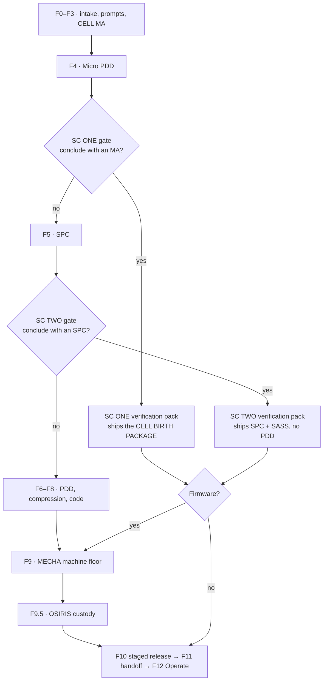

# SHORT SPRINTS: Add-on PDD for the ARK Harness

13 October 2026 · OLUSEYE AMUSA

## Part 0 — Title and contents

SHORT SPRINTS adds two early exits to the ARK Harness, so a small or medium project can finish without going through all fifteen stages. Every exit still passes a verification pack and then F10 release, F11 handoff and F12 Operate. Firmware always goes through F9 as well.

| Field | Value |
| --- | --- |
| Document | SHORT SPRINTS — Add-on PDD for the ARK Harness, v1.0 |
| Production ID | JNGL-ARKH-PDD-SS-2026-001 (checked only against IDs visible in project documents) |
| Standard | ATLAS 360 PLAN v4.0.1, 12-Part PDD |
| Adds to | ARK Harness F0–F12 (ATLAS 360 SCAN stages plus F12 from JNGL-ARKH-PDD-RDY-2026-001) |
| Depends on | XVL v1.1 (tracks and profiles); COMMAND DECK MAX v1.0 (trace and streams); VTE v1.0 (failure cases); ARK Harness Upgrade v1.0 (F10 release safety, F12, Track A) |
| Author / Principal | Oluseye Shay Amusa — Junglenomics · Koncentric Labs · Idea Factory |
| Drafting model | Claude (claude-opus-5-5). AI-drafted; requires human review |
| Status | DRAFT v1.0 — Tier 0: specified, not built; no independent review |
| JCSE | Not asserted |
| GRO mode | HUMAN\_IN\_LOOP: the owner answers each exit question; nothing exits automatically |

**The two short circuits.**

| Circuit | Exit point | The Harness asks | What ships | Then |
| --- | --- | --- | --- | --- |
| **SC ONE — Standalone Molecular Agent** | After F4 (MA plus Micro PDD) | "Do you want to conclude this process with a Molecular Agent, or continue?" | The CELL BIRTH PACKAGE: the MA, its 3-document Micro PDD and Interface Contract | SC ONE verification pack → F10 → F11 → F12 |
| **SC TWO — Standalone SPC** | After F5 (SPC) | "Do you want to conclude this process with a standalone SPC, or continue?" | The SPC plus a Standalone Agent Spec Sheet, with no PDD | SC TWO verification pack → F10 → F11 → F12 |
| Firmware branch (either circuit) | Same gates | Same question | Firmware target | Verification pack → **F9 MECHA** → F10 → F11 → F12 |

**Three project scales, one Harness.**

| Scale | Typical project | Route | Stages run |
| --- | --- | --- | --- |
| Small | One task, one tool: an email triage agent, a data logger | SC ONE | F0–F4, pack, F10–F12 (F9 if firmware) |
| Medium | A more advanced agent with a stable persona, several tools and machine-readable contracts | SC TWO | F0–F5, pack, F10–F12 (F9 if firmware) |
| Full | A multi-agent system or Agent-as-a-Service platform with its own codebase | Full path | F0–F12, all fifteen stages |

**Contents.** Route map · Part 1 requirements · Part 2 business case · Part 3 roster · Part 4 platform specifics · Part 5 worksheet · Part 6 implementation · Parts 7–11 · Appendices.

### Route map

A No answer at either gate continues the full path with nothing lost. A short-route firmware product goes from F9 straight to F10; its custody record is already in the verification pack.

## Part 1 — Requirements, invariants and reconciliation

*Owning SPCs: ATLAS 360 PLAN + MATHMON*

**Problem.** Today every ARK project runs the same fifteen stages. A one-tool email triage agent pays the same process cost as an Agent-as-a-Service platform: an ATLAS PDD, SPARTAN compression, Code ORACLE, the MECHA floor and OSIRIS custody. Owners of small projects either skip the Harness or abandon it part way, and then nothing is verified at all. SHORT SPRINTS makes the short route an official route with its own verification, instead of an unofficial shortcut with none.

**Goal.** Shorter cycles for small and medium projects with no loss of verification: every product that leaves the Harness, on any route, has passed a verification pack, a staged F10 release and an F11 handoff, and runs under F12.

### Functional requirements

| ID | Requirement | Priority |
| --- | --- | --- |
| SS-FR-01 | After F4 is certified, the Harness asks the owner: "Do you want to conclude this process with a Molecular Agent, or continue?" | P0 |
| SS-FR-02 | After F5 is certified, the Harness asks: "Do you want to conclude this process with a standalone SPC, or continue?" | P0 |
| SS-FR-03 | Before asking, the Harness runs the eligibility check for that circuit. If the project is not eligible, the Yes answer is disabled and the failed rules are shown in plain language | P0 |
| SS-FR-04 | A Yes answer is recorded with the owner's name, time, reason and the eligibility result; a No answer continues the full path with nothing lost | P0 |
| SS-FR-05 | SC ONE ships the CELL BIRTH PACKAGE (MA Classification Report, 3-document Micro PDD, Interface Contract v1.0) after the SC ONE verification pack passes | P0 |
| SS-FR-06 | SC TWO ships the SPC and a Standalone Agent Spec Sheet (SASS), with no PDD, after the SC TWO verification pack passes | P0 |
| SS-FR-07 | Both circuits then go to F10 (staged release), F11 (handoff) and F12 (Operate). A firmware target goes through F9 MECHA first | P0 |
| SS-FR-08 | Every stage a circuit skips is written to the trace as SKIPPED\_BY\_SC with the circuit and reason, never left blank | P0 |
| SS-FR-09 | A short-sprint product can be promoted back into the full path at F5 (from SC ONE) or F6 (from SC TWO), carrying its lineage, without redoing earlier stages | P1 |
| SS-FR-10 | The Command Deck reports cycle time, first-pass gate rate and F12 incidents per circuit, so the short routes can be compared with the full path | P1 |
| SS-FR-11 | The owner can withdraw a Yes answer at any time before F10 starts and resume the full path | P1 |

### Invariants

These hold on every route. A change that breaks one is rejected.

| ID | Invariant |
| --- | --- |
| SS-INV-01 | **No exit without verification.** No product reaches F10 without a passing verification pack for its circuit |
| SS-INV-02 | **No automatic exit.** Only a named human answers the SC question; the Harness never answers Yes on the owner's behalf (GRO HUMAN\_IN\_LOOP) |
| SS-INV-03 | **Firmware always meets F9.** Any product that runs on a physical device passes MECHA, with external evidence, before F10 |
| SS-INV-04 | **F10–F12 are never skipped.** Every route ends with staged release, handoff and Operate |
| SS-INV-05 | **Skipped means recorded.** Every skipped stage appears in the trace as SKIPPED\_BY\_SC; certificates name the circuit |
| SS-INV-06 | **Honest labels.** A short-sprint product carries its circuit on its certificate (for example "SC ONE · Evidence-Backed"); it is never shown as having passed stages it skipped |
| SS-INV-07 | **Profile floors still apply.** The XVL profile chosen at F0 sets the minimum tracks; a short circuit can add checks but never drop below the floor |

### Reconciliation

- **"Molecular Agent" and "CELL MA".** This PDD's Molecular Agent (MA) is the same thing Command Deck MAX calls a CELL MA: the product of F3 and F4 under the CELL SPC rules. No new agent type is introduced.
- **The stage count.** "All fifteen stages" means F0, F0.5, F1–F9, F9.5, F10, F11 and F12, as listed after the Upgrade PDD added F12.
- **The SPC.** SC TWO ships the F5 SPC card (15 sections, with SPEC BUILDER JSON I/O contracts). The SASS is a derived deployment sheet, not a second spec; where they differ, the SPC wins.
- **"Without a PDD".** SC TWO skips the F6 ATLAS PDD. The F4 Micro PDD made earlier in the run is kept as lineage but is not part of the SC TWO deliverable.
- **CELL limits.** The MA rules (at most 3 prompts, at most 1 tool, at most 90 minutes to build) come from the CELL SPC and are not changed here; they become the SC ONE eligibility rules.

### Out of scope

- Changing what F0–F5 produce. SHORT SPRINTS only adds gates after F4 and F5.
- A third circuit exiting after F6 or F7. Noted as OD-SS-04.
- Any change to the XVL tracks, the Command Deck trace contract or VTE beyond the additions listed in Part 4.

## Part 2 — Business case and validation

*Owning SPCs: PLUTUS + ATHENA*

**Value proposition.** One Harness for three sizes of project. Atanda can sell and teach the ARK process to a small business that wants one working agent next week, to a team that needs a dependable advanced agent, and to an enterprise building an Agent-as-a-Service platform, without a separate method for each. Every route ends in the same verified, released and operated product, so the Junglenomics evidence story holds at every price point.

| Who benefits | Before | With SHORT SPRINTS |
| --- | --- | --- |
| Small-business owner or non-technical learner | Must sit through PDD, compression and code stages for a single-task agent, or skip the Harness | Exits after F4 with a tested MA in a VIBE app (Lovable, Bolt.new, Cursor, Replit), released and monitored |
| Team building an advanced agent | A full ATLAS PDD for an agent that runs on a host platform and has no codebase | Exits after F5 with an SPC and a deployable spec sheet |
| Enterprise / AaaS | Same as today | Unchanged: the full path |
| Atanda training programme | One long track | Three graded tracks (SC ONE, SC TWO, full) that build on each other |
| Command Deck MAX | Triplets mostly from full-path runs | More Stream A and B captures from short runs, with the circuit recorded |

### Expected effect on cycle time

These are planning estimates for the Principal to confirm, not measurements \[SYNTH\]. They assume the stage effort is roughly proportional to the documents each stage produces.

| Route | Stages run | Planning estimate |
| --- | --- | --- |
| SC ONE | F0–F4, pack, F10–F12 | Hours to two days. CELL caps build time at 90 minutes; the pack and a 5→25→100% release add the rest |
| SC TWO | F0–F5, pack, F10–F12 | Days to about two weeks |
| Full path | F0–F12 | Weeks to months, as today |

### Risks

| Risk | Effect | Control |
| --- | --- | --- |
| Owners choose a short circuit for a project that is too big | An under-specified agent reaches users | Eligibility check disables Yes (SS-FR-03); F12 incidents per circuit are tracked (SS-FR-10) |
| The pack becomes a box-ticking step | Short routes look verified but are not | Pack uses external tracks (E, R) at I1 or higher, not self-checks; failures open VTE cases |
| Regulated work slips through the short route | Compliance gaps | Regulated profile allowed only with Tracks H and C (Part 4.2) |
| Firmware ships without physical testing | Device harm | SS-INV-03: firmware always meets F9 with external evidence |
| Short-route products pile up and later need a full PDD | Rework | Promotion re-enters at F5 or F6 with lineage, no repeat of F0–F4 |

### Validation

SHORT SPRINTS is judged successful only on measured outcomes, reviewed after the first 30 short-circuit releases (threshold OD-SS-05):

- median cycle time per circuit is lower than the full path for comparable intake sizes;
- first-pass verification pack rate, reported with sample size;
- F12 incident rate and change failure rate per circuit are no worse than the full path, within the stated sample sizes;
- the share of short-route products later promoted, and why.

If the short routes show a higher incident rate, eligibility is tightened before scope is widened.

## Part 3 — SPC roster

*Owning SPC: ATLAS 360 PLAN*

No new SPC is introduced. Existing SPCs take on the roles below.

| SPC | Role in SHORT SPRINTS |
| --- | --- |
| **ARK Harness / FORGE.BONSAI** | Hosts the SC gates and routing; asks the exit question |
| **MATHMON** | Writes the eligibility rules and the SKIPPED\_BY\_SC stage logic; checks invariants |
| **CELL** | Produces the MA and CELL BIRTH PACKAGE; runs LYSOSOME stress tests inside the SC ONE pack |
| **SPEC BUILDER v9.1** | Supplies the JSON I/O contracts that make an SPC eligible for SC TWO |
| **CORDON** | Generates the Standalone Agent Spec Sheet from the SPC |
| **BUGMXT** | Runs Track R injection and poisoned-premise probes in the pack |
| **HIVE** | Runs the verification pack through XVL and records results |
| **OSIRIS** | Writes the minimal custody record and signs the pack result |
| **MECHA** | Runs F9 for firmware targets |
| **HOST DJ** | F10 staged release and F11 handoff for short-route products |
| **VIBE DJ** | Packages SC ONE products for the chosen VIBE app |
| **ATHENA** | Rolls up cycle time and incident rate per circuit |
| **KLARITY** | Writes the plain-language exit question, ineligibility reasons and certificates |
| **SPHINX** | Approves promotion back into the full path |

## Part 4 — Platform specifics

*Owning SPCs: ARK Harness + MATHMON + CELL + CORDON + HIVE*

### 4.1 The SC gates

Each gate opens only after its stage is certified. The Harness then runs the eligibility check, shows the result and asks the question. Nothing is sent onward until the owner answers.

| Gate | Opens after | Question | Yes | No |
| --- | --- | --- | --- | --- |
| **SC ONE** | F4 Micro PDD certified | "Do you want to conclude this process with a Molecular Agent, or continue?" | SC ONE pack → (F9 if firmware) → F10 → F11 → F12 | Continue to F5 |
| **SC TWO** | F5 SPC certified | "Do you want to conclude this process with a standalone SPC, or continue?" | SASS generated → SC TWO pack → (F9 if firmware) → F10 → F11 → F12 | Continue to F6 |

The gate screen shows: the eligibility result rule by rule; what will ship; which stages will be skipped; the verification tracks that will run; and the target (VIBE app, host platform or firmware). The owner answers Yes, No, or "ask me later" (the project waits at the gate).

**Gate event.** Each answer writes an `sc_gate_decision` trace event: trace\_id, gate (SC\_ONE or SC\_TWO), decision (YES, NO, DEFERRED, WITHDRAWN), owner, timestamp, reason, eligibility result and rule hashes, target type, and XVL profile.

### 4.2 Eligibility

| Rule | SC ONE | SC TWO |
| --- | --- | --- |
| Size | At most 3 prompts (CELL MA-001) | Any number of prompts, all certified at F2 |
| Tools | At most 1 tool; more triggers CELL GRO escalation | Tools listed with permissions in the SPC |
| Build time | At most 90 minutes (CELL MA-002) | No limit |
| Contracts | Interface Contract v1.0 (JSON) present | SPEC BUILDER JSON I/O contracts present and valid |
| Codebase | None: runs in a VIBE app or as a no-code agent | None: deploys to a host platform by configuration; no separate codebase to build |
| Multi-agent | No | No; a system of several agents goes to the full path |
| Firmware | Allowed; forces F9 | Allowed; forces F9 |
| XVL profile | Prototype Light or Standard; Regulated only with Tracks H and C added | Same |
| Open blockers | No open CRITICAL finding from F0–F4 | No open CRITICAL finding from F0–F5 |

If any rule fails, Yes is disabled and the failed rules are shown in plain language, for example: "This agent uses 2 tools; a Molecular Agent can use 1. Continue to F5, or reduce to one tool."

### 4.3 SC ONE — Standalone Molecular Agent

**Ships:** the CELL BIRTH PACKAGE — MA Classification Report; the 3-document Micro PDD (Cheat Sheet, PromptWare Worksheet, Build & Launch Instructions); Interface Contract v1.0 (JSON) — plus the SC ONE pack result and certificate.

**Targets:** Lovable, Bolt.new, Cursor or Replit, packaged by VIBE DJ; a no-code agent host; or a firmware device (then F9).

**Naming:** CELL convention FUNCTION.TOOL.OWNER\_TAG, with the circuit added to the certificate, not the name.

### 4.4 SC TWO — Standalone SPC

**Ships:** the F5 SPC card (15 sections), the Standalone Agent Spec Sheet, the SC TWO pack result and certificate. No ATLAS PDD.

**Use:** more advanced agents — a stable persona, several tools, stricter contracts — deployed to a host platform (for example an assistant builder, an agent framework configuration or an enterprise copilot) without a separate codebase.

### 4.5 Standalone Agent Spec Sheet (SASS)

CORDON generates the SASS from the SPC. It is what a builder needs to deploy and run the agent; it replaces the PDD for this route. Fields:

| # | Field | Source |
| --- | --- | --- |
| 1 | Identity: name, version, owner, circuit | SPC §1 |
| 2 | Mission and scope, including what the agent does not do | SPC |
| 3 | System prompt and core prompts, each F2-certified across the 7 Context Craft pillars | F2 |
| 4 | JSON input and output contracts | SPEC BUILDER |
| 5 | Tools and permissions (allowlist, scopes, rate limits) | SPC |
| 6 | Constraints and NEVER list | SPC |
| 7 | GRO states and escalation rules | SPC |
| 8 | Fail-closed rules: what the agent does when a tool, input or credential fails | SPC + pack |
| 9 | Evalset hashes and pack result | XVL |
| 10 | Deployment target and host configuration | Owner |
| 11 | Model and provider, with fallback | Owner |
| 12 | Data handling and custody: what is stored, where, for how long | SPC + OSIRIS |
| 13 | Monitoring: F12 signals and on-call owner | F12 |
| 14 | Version and change log | OSIRIS |
| 15 | Promotion notes: what a full PDD would add | CORDON |

A SASS that does not match its SPC fails the pack (SCV check).

### 4.6 The verification pack

The pack covers the risks that the skipped stages would normally catch. It runs through XVL; results go to the trace and, on failure, to VTE.

| Check | What it covers | Track | SC ONE | SC TWO |
| --- | --- | --- | --- | --- |
| Unit and trajectory tests | Correct output and tool use on the evalset | E | Required | Required |
| LYSOSOME stress | Invalid input, missing credential, boundary overflow | E | Required | Required |
| Contract conformance | Every output validates against the JSON contracts | E | Required | Required |
| Injection and poisoned-premise probes | Prompt injection; building on a refuted claim (XVL v1.1) | R | Required | Required |
| Fail-closed probes | The F9-equivalent checks for non-firmware: tool failure, timeout, credential loss end safely | E | Required | Required |
| Cross-model judge | Quality on open-ended outputs | J | Optional | Required |
| SASS–SPC match | Spec sheet matches the certified SPC | S | — | Required |
| Minimal custody record | Hashes of all shipped files, versions, approver | C (OSIRIS) | Required | Required |
| Provider check | Model and provider terms allow the use | P | At F10 | At F10 |
| Agent readiness | Track A signals | A | Only if code is deployed | Only if code is deployed |
| Human review | Named reviewer | H | Regulated profile | Regulated profile |

**Independence.** Tracks E and R run at I1 or higher. A pack passed only by self-checks (I0) cannot release.

**Result.** PASS releases to F10 (or F9). FAIL returns the project to the stage that owns the failure (F2, F3, F4 or F5) and opens a VTE failure case. INCONCLUSIVE holds at the gate.

### 4.7 Firmware routing

If the target is a physical device, the pack passes the product to F9 MECHA, which runs its seven phases, fail-closed, with external evidence, before F10. Whether MECHA can build from a Micro PDD or SASS without the F7 and F8 outputs it normally receives is open (OD-SS-01). Until that is decided, MECHA may refuse a short-route firmware job and send it to the full path; it never accepts one with missing evidence.

### 4.8 F10, F11 and F12 for short-route products

The Upgrade PDD's rules apply unchanged: a release plan, staged steps (5%, 25%, 100% by default), health checks with automatic rollback, a signed release record, handoff to the host connector, and F12 incident handling. For a single-user product with no traffic to split, the steps become a supervised trial run, then general use.

### 4.9 Promotion back to the full path

A short-route product can grow. On SPHINX approval it re-enters:

- from SC ONE at F5, carrying the Micro PDD and pack results as inputs to the SPC;
- from SC TWO at F6, carrying the SPC and SASS as inputs to the ATLAS PDD.

The trace links the new run to the old with parent\_trace\_id. Earlier stages are not repeated. The live short-route version stays in F12 until the promoted version is released.

### 4.10 Trace and telemetry

| Addition | Detail |
| --- | --- |
| Stage status | New status SKIPPED\_BY\_SC on every skipped stage, with circuit and reason |
| Events | `sc_gate_decision`, `sc_pack_result`, `sc_promotion` added to the Command Deck trace contract |
| Streams | SC ONE captures to Stream B (CELL MA); SC TWO captures to Stream A (SPC); consent and GRO gate unchanged |
| VTE | Pack FAILs at I1 or higher open failure cases as for any external verdict |
| Outcome metrics | Cycle time, first-pass pack rate, autonomy ratio, governance touches, change failure rate and incidents, all split by circuit |

## Part 5 — Atomic prompt worksheet

*Owning SPCs: ATLAS 360 PLAN + CORDON*

40 atomic prompts in 9 features, joined by 49 dependencies, sequenced into 8 waves. A script computed the waves, found no cycles and applied priority inheritance. Prompts in XVL, Command Deck MAX, VTE, CELL and the Upgrade PDD that SHORT SPRINTS relies on are external prerequisites, listed in their own column and kept out of the graph.

| Measure | Value |
| --- | --- |
| Atomic prompts | 40 in 9 features |
| Dependencies | 49 |
| Build waves | 8 |
| Starting points | 8: SS-GOV-001, GOV-002, TRC-001, ELG-001, ELG-002, RTE-001, SASS-001, SCV-001 |
| End points | 11 |
| Cycles | 0 |
| Priority as declared | P0 28 · P1 11 · P2 1 |
| Priority after inheritance | P0 30 · P1 9 · P2 1 |

**Inheritance.** SS-ELG-005 (plain-language ineligibility reasons) rose from P1 to P0, because the P0 gate screen (SS-GATE-003) shows them. SS-SCV-006 (Track J judging) rose to P0, because the P0 pack result (SS-SCV-008) cannot be computed for SC TWO without it.

**Critical path (8 waves).** SS-ELG-001 → ELG-003 → GATE-001 → GATE-003 → GATE-004 → RTE-002 → RTE-003 → RTE-004. Routing cannot be set until the gate records an answer, and the gate cannot open until eligibility is evaluated. The verification pack (SCV-001 → SCV-008) runs in parallel and joins at RTE-003.

**External prerequisites.** Upgrade PDD: UPG-STG-001 (F12 in the stage list), UPG-OUT-003 and UPG-OUT-006 (outcome rollups and panel). Command Deck MAX: CD-TRC-001, CD-TRC-006, CD-GOV-006 and the audit log. XVL: XVL-GOV-001, XVL-SEL-001, XVL-TRK-002, -003, -005, Track J and the v1.1 premise checks. VTE: VTE-FCL-001. CELL: MA-001, MA-002 and LYSOSOME. SPEC BUILDER v9.1 contracts. MECHA phase 1 intake.

**GOV — Governance** (2 prompts)

| ID | Atomic prompt | Owner | P | Depends on | External prerequisite | Wave |
| --- | --- | --- | --- | --- | --- | --- |
| SS-GOV-001 | Register who may answer each SC gate for a project (owner and delegates); reuse the XVL approver registry. | OSIRIS | P0 | — | XVL-GOV-001 | W1 |
| SS-GOV-002 | Write an audit event for every gate answer, withdrawal, pack result and promotion. | OSIRIS | P0 | — | CD audit log | W1 |

**TRC — Trace and telemetry** (4 prompts)

| ID | Atomic prompt | Owner | P | Depends on | External prerequisite | Wave |
| --- | --- | --- | --- | --- | --- | --- |
| SS-TRC-001 | Add SKIPPED\_BY\_SC to the stage status enum, with circuit and reason fields. | MATHMON | P0 | — | CD-TRC-001 | W1 |
| SS-TRC-002 | Add sc\_gate\_decision, sc\_pack\_result and sc\_promotion to the trace contract and capture map; reject unknown values. | HIVE | P0 | SS-TRC-001 | CD-TRC-006 | W2 |
| SS-TRC-004 | Route SC ONE captures to Stream B and SC TWO captures to Stream A through the existing consent check and GRO gate. | HIVE | P1 | SS-TRC-002 | CD-GOV-006 | W3 |
| SS-TRC-003 | Write SKIPPED\_BY\_SC for every stage a circuit bypasses at the moment the route is set. | HIVE | P0 | SS-TRC-002, SS-RTE-002 | — | W7 |

**ELG — Eligibility** (5 prompts)

| ID | Atomic prompt | Owner | P | Depends on | External prerequisite | Wave |
| --- | --- | --- | --- | --- | --- | --- |
| SS-ELG-001 | Write the SC ONE eligibility rules: at most 3 prompts, 1 tool, 90 minutes, Interface Contract present, no codebase, no open CRITICAL. | MATHMON | P0 | — | CELL MA-001, MA-002 | W1 |
| SS-ELG-002 | Write the SC TWO eligibility rules: F2-certified prompts, valid JSON I/O contracts, host-deployable by configuration, single agent, no open CRITICAL. | MATHMON | P0 | — | SPEC BUILDER v9.1 | W1 |
| SS-ELG-003 | Evaluate eligibility from certified stage outputs and store each rule result with its hash. | HIVE | P0 | SS-ELG-001, SS-ELG-002 | — | W2 |
| SS-ELG-004 | Allow the Regulated profile on a short circuit only when Tracks H and C are added. | HIVE | P0 | SS-ELG-003 | XVL-SEL-001 | W3 |
| SS-ELG-005 | Write a plain-language reason and a fix for every failed eligibility rule. | KLARITY | P0↑ | SS-ELG-003 | — | W3 |

**GATE — SC gates** (5 prompts)

| ID | Atomic prompt | Owner | P | Depends on | External prerequisite | Wave |
| --- | --- | --- | --- | --- | --- | --- |
| SS-GATE-001 | Open the SC ONE gate when F4 is certified and ask the exact SC ONE question. | ARK HARNESS | P0 | SS-ELG-003, SS-GOV-001 | — | W3 |
| SS-GATE-002 | Open the SC TWO gate when F5 is certified and ask the exact SC TWO question. | ARK HARNESS | P0 | SS-ELG-003, SS-GOV-001 | — | W3 |
| SS-GATE-003 | Show the gate screen: eligibility by rule, what ships, stages skipped, tracks to run, target. | KLARITY | P0 | SS-GATE-001, SS-GATE-002, SS-ELG-005 | — | W4 |
| SS-GATE-004 | Record YES, NO or DEFERRED with owner, time, reason and eligibility hash; disable YES when ineligible. | ARK HARNESS | P0 | SS-GATE-003, SS-TRC-002 | — | W5 |
| SS-GATE-005 | Let the owner withdraw YES before F10 starts and resume the full path at the next stage. | ARK HARNESS | P1 | SS-GATE-004 | — | W6 |

**RTE — Routing** (4 prompts)

| ID | Atomic prompt | Owner | P | Depends on | External prerequisite | Wave |
| --- | --- | --- | --- | --- | --- | --- |
| SS-RTE-001 | Define the three routes (SC ONE, SC TWO, full) and the firmware branch as a stage graph with no path that skips F10–F12. | MATHMON | P0 | — | UPG-STG-001 | W1 |
| SS-RTE-002 | Set the route from the gate answer and the target type. | ARK HARNESS | P0 | SS-RTE-001, SS-GATE-004 | — | W6 |
| SS-RTE-003 | Send a passed pack to F9 MECHA for a firmware target, otherwise to F10. | ARK HARNESS | P0 | SS-RTE-002, SS-SCV-008 | — | W7 |
| SS-RTE-004 | Refuse a short-route firmware job when required evidence is missing and return it to the full path. | MECHA | P0 | SS-RTE-003 | MECHA phase 1 | W8 |

**SASS — Standalone Agent Spec Sheet** (4 prompts)

| ID | Atomic prompt | Owner | P | Depends on | External prerequisite | Wave |
| --- | --- | --- | --- | --- | --- | --- |
| SS-SASS-001 | Define the 15-field Standalone Agent Spec Sheet schema and its mapping from SPC sections. | CORDON | P0 | — | — | W1 |
| SS-SASS-002 | Generate the SASS from a certified SPC, filling owner fields from the gate screen. | CORDON | P0 | SS-SASS-001 | SPEC BUILDER v9.1 | W2 |
| SS-SASS-003 | Check that every SASS field matches its SPC source; any mismatch fails the pack. | HIVE | P0 | SS-SASS-002 | — | W3 |
| SS-SASS-004 | Write the promotion notes field: what a full PDD would add for this agent. | KLARITY | P1 | SS-SASS-002 | — | W3 |

**SCV — Verification pack** (10 prompts)

| ID | Atomic prompt | Owner | P | Depends on | External prerequisite | Wave |
| --- | --- | --- | --- | --- | --- | --- |
| SS-SCV-001 | Define the SC ONE and SC TWO pack contents, tracks and minimum independence (I1 for E and R). | HIVE | P0 | — | XVL-TRK-002 | W1 |
| SS-SCV-002 | Run unit, trajectory and contract-conformance tests on the evalset through Track E. | HIVE | P0 | SS-SCV-001 | XVL-TRK-003 | W2 |
| SS-SCV-003 | Run LYSOSOME stress on invalid input, missing credential and boundary overflow. | CELL | P0 | SS-SCV-001 | CELL LYSOSOME | W2 |
| SS-SCV-004 | Run Track R injection and poisoned-premise probes. | BUGMXT | P0 | SS-SCV-001 | XVL-TRK-005; XVL v1.1 | W2 |
| SS-SCV-005 | Run fail-closed probes: tool failure, timeout and credential loss must end safely. | BUGMXT | P0 | SS-SCV-001 | — | W2 |
| SS-SCV-006 | Run Track J cross-model judging for SC TWO open-ended outputs. | HIVE | P0↑ | SS-SCV-001 | XVL Track J | W2 |
| SS-SCV-007 | Write a minimal custody record: hashes of shipped files, versions, approver. | OSIRIS | P0 | SS-SCV-001 | — | W2 |
| SS-SCV-008 | Combine checks into PASS, FAIL or INCONCLUSIVE; refuse PASS on I0-only evidence; write sc\_pack\_result. | HIVE | P0 | SS-SCV-002, SS-SCV-003, SS-SCV-004, SS-SCV-005, SS-SCV-006, SS-SCV-007, SS-SASS-003, SS-ELG-004 | — | W4 |
| SS-SCV-009 | On FAIL, return the project to the owning stage and open a VTE failure case. | HIVE | P0 | SS-SCV-008 | VTE-FCL-001 | W5 |
| SS-SCV-010 | Issue the certificate with the circuit and XVL conformity state; never list skipped stages as passed. | KLARITY | P1 | SS-SCV-008 | — | W5 |

**PRM — Promotion** (3 prompts)

| ID | Atomic prompt | Owner | P | Depends on | External prerequisite | Wave |
| --- | --- | --- | --- | --- | --- | --- |
| SS-PRM-001 | Approve promotion of a short-route product into the full path. | SPHINX | P1 | SS-RTE-001, SS-TRC-002 | — | W3 |
| SS-PRM-002 | Re-enter at F5 from SC ONE or F6 from SC TWO with parent\_trace\_id and the earlier outputs as inputs. | ARK HARNESS | P1 | SS-PRM-001 | — | W4 |
| SS-PRM-003 | Keep the short-route version live in F12 until the promoted version is released. | HOST DJ | P1 | SS-PRM-002 | — | W5 |

**OUT — Outcome metrics** (3 prompts)

| ID | Atomic prompt | Owner | P | Depends on | External prerequisite | Wave |
| --- | --- | --- | --- | --- | --- | --- |
| SS-OUT-001 | Split cycle time, first-pass pack rate, change failure rate and incidents by circuit. | ATHENA | P1 | SS-TRC-002 | UPG-OUT-003 | W3 |
| SS-OUT-002 | Add a circuit filter to the Command Deck outcomes panel, with sample sizes on every figure. | KLARITY | P1 | SS-OUT-001 | UPG-OUT-006 | W4 |
| SS-OUT-003 | Produce the review report after the first 30 short-circuit releases. | ATHENA | P2 | SS-OUT-001 | — | W4 |

## Part 6 — DJ implementation plan

*Owning SPCs: CODE DJ + HOST DJ + VIBE DJ*

Four phases. Each ends at a gate the Principal signs. The Upgrade PDD's P0 prerequisites (F12 in the stage list, F10 staged release, the SEC REP ONE critical controls) must be in place before Phase 3 releases anything to users.

| Phase | Waves | Builds | Exit gate |
| --- | --- | --- | --- |
| **1 — Rules and contracts** | W1–W2 | Eligibility rules, route graph, SASS schema, pack definition, trace additions, approver registry | MATHMON shows no route in the graph skips F10–F12, and firmware always meets F9 |
| **2 — Gates and pack** | W2–W5 | Eligibility evaluator, both gates and the gate screen, SASS generator and match check, all pack checks, pack result, VTE hand-off | Both gates run end to end on test projects; a deliberately ineligible project cannot answer Yes; a seeded failure opens a VTE case |
| **3 — Routing and release** | W6–W8 | Route setting, SKIPPED\_BY\_SC records, F9/F10 routing, MECHA refusal, certificates | Pilot: 3 SC ONE and 2 SC TWO projects reach F12 through staged release; one firmware project reaches F9 or is correctly refused |
| **4 — Promotion and outcomes** | W3–W5 (P1) | Promotion, withdrawal, per-circuit outcomes and panel | One pilot product promoted to the full path without repeating F0–F4; outcome panel shows per-circuit figures with sample sizes |

### Pilot design

Pilot projects are chosen to test the edges, not just the easy cases:

| Pilot | Circuit | Purpose |
| --- | --- | --- |
| Email triage MA in Lovable | SC ONE | Typical small project |
| Data logger MA on a microcontroller | SC ONE, firmware | Exercises F9 and OD-SS-01 |
| Invoice-check MA with 2 tools | (ineligible) | Must be refused at the SC ONE gate and continue to F5 |
| Customer-support SPC on a host platform | SC TWO | Typical medium project |
| Regulated intake SPC | SC TWO, Regulated | Must require Tracks H and C |
| Promotion of the support SPC | SC TWO → F6 | Tests lineage and the no-repeat rule |

### Training track (Atanda)

The circuits map onto three graded course levels: SC ONE as the entry level for non-technical learners (one working, tested agent); SC TWO as the intermediate level (spec-driven advanced agents); the full path as the advanced level (AaaS platforms). Each level ends with a real release through F10–F12, so learners see verification as part of shipping, not a separate step.

## Part 7 — Sources

All internal; no external source was needed for this add-on.

- CELL SPC v1.0 (MA rules MA-001, MA-002; GRO escalation; CELL BIRTH PACKAGE; LYSOSOME)
- SPEC BUILDER (ARK Harness v9.1 PDD) — JSON I/O contracts at F5
- ATLAS 360 SCAN of the ARK Harness (stage list F0–F11, 23 September 2026)
- ARK Harness Upgrade PDD v1.0 (JNGL-ARKH-PDD-RDY-2026-001) — F12, F10 staged release, Track A, outcome metrics
- FORGE.BONSAI External Verification Layer PDD v1.1 — tracks, independence levels, profiles, premise integrity
- COMMAND DECK MAX PDD v1.0 (JNGL-PDD-CMDDECKMAX-2026-001) — trace contract, Streams A and B
- Verification Telemetry Engine PDD v1.0 — failure cases

## Part 8 — Terms

| Term | Meaning |
| --- | --- |
| Short circuit (SC) | An official early exit from the full F-process, with its own verification pack |
| Molecular Agent (MA) | A small agent made at F3–F4 under CELL rules; the same as the Command Deck's CELL MA |
| CELL BIRTH PACKAGE | The 5 documents CELL ships with an MA |
| SASS | Standalone Agent Spec Sheet, the deployment sheet that replaces the PDD on SC TWO |
| Verification pack | The checks a short-route product must pass before F9 or F10 |
| SKIPPED\_BY\_SC | Trace status for a stage a circuit bypasses |
| Promotion | Moving a short-route product back into the full path at F5 or F6 |

## Part 9 — IP

SHORT SPRINTS, the SC gates, the verification pack and the SASS are Junglenomics designs owned by the Principal. VIBE app names (Lovable, Bolt.new, Cursor, Replit) refer to third-party products used as deployment targets; no affiliation is implied. Pack results and certificates name the circuit so that no short-route product is presented as having passed the full process.

## Part 10 — Security

- Short routes skip SPARTAN, Code ORACLE and the full OSIRIS stage, so the pack carries their security checks: injection and poisoned-premise probes (Track R), fail-closed probes, tool allowlists from the SPC and a custody record.
- Tool permissions in the SASS are an allowlist; a tool not listed is refused at run time by the host configuration.
- Secrets are never written into a Micro PDD, SPC or SASS; they are referenced by name from the key store (UPG-SEC-002).
- Short-route products use the same F10 staged release and automatic rollback as the full path.
- No short-route product may be offered self-hosted or air-gapped until the SEC REP ONE critical controls are closed (UPG-SOV-004).

## Part 11 — Regulatory

- The XVL profile set at F0 still applies. A Regulated project can use a short circuit only with Tracks H (named human reviewer) and C (custody and compliance) added to its pack.
- Health, financial or legal agents follow their card's own rules on top of this; for example, any ERB-derived agent is bound by the ERB re-certification spec.
- Consent for Command Deck capture is OFF by default and is not changed by the circuit.
- Nothing here is legal advice; the Regulated profile's reviewer decides what a given jurisdiction requires.

## Appendices

### A — Open decisions

- [ ] OD-SS-01: Can F9 MECHA build firmware from a Micro PDD or SASS without the F7 and F8 outputs it normally receives? Until decided, MECHA may refuse and send the job to the full path
- [ ] OD-SS-02: Confirm the SC TWO definition of "host-deployable by configuration": which host platforms qualify
- [ ] OD-SS-03: Should Track J be required for SC ONE as well as SC TWO?
- [ ] OD-SS-04: Add a third circuit that exits after F6 (PDD, no code) or F7 (compressed and certified)?
- [ ] OD-SS-05: The review threshold: first 30 short-circuit releases, or a time window
- [ ] OD-SS-06: Who can answer the gate on a client project: the client owner, the Atanda FDE, or both
- [ ] OD-SS-07: Confirm the cycle-time planning estimates in Part 2 or replace them with pilot measurements

### B — Honesty Gate

| Claim type | Where used |
| --- | --- |
| \[SPEC\] | CELL rules, SPC structure, XVL tracks, Command Deck streams and trace fields, as written in project documents |
| \[INT\]† | The mapping of skipped-stage risks to pack checks (Part 4.6), the eligibility rules for SC TWO and the SASS fields — drafted here, not yet reviewed |
| \[SYNTH\] | Cycle-time estimates in Part 2 |

- Status is Tier 0: specified, not built. No pack has been run and no circuit has been piloted.
- JCSE is not asserted.
- Worksheet counts, waves and the critical path come from a script, not by hand.
- "Fifteen stages" counts F0, F0.5, F1–F9, F9.5, F10, F11 and F12.

### C — Version history

| Version | Date | Change | By |
| --- | --- | --- | --- |
| 1.0 | 13 October 2026 | First draft: SC ONE and SC TWO gates, eligibility, SASS, verification pack, firmware routing, promotion, telemetry, 40-prompt worksheet | Claude (drafting) for Oluseye Shay Amusa |
