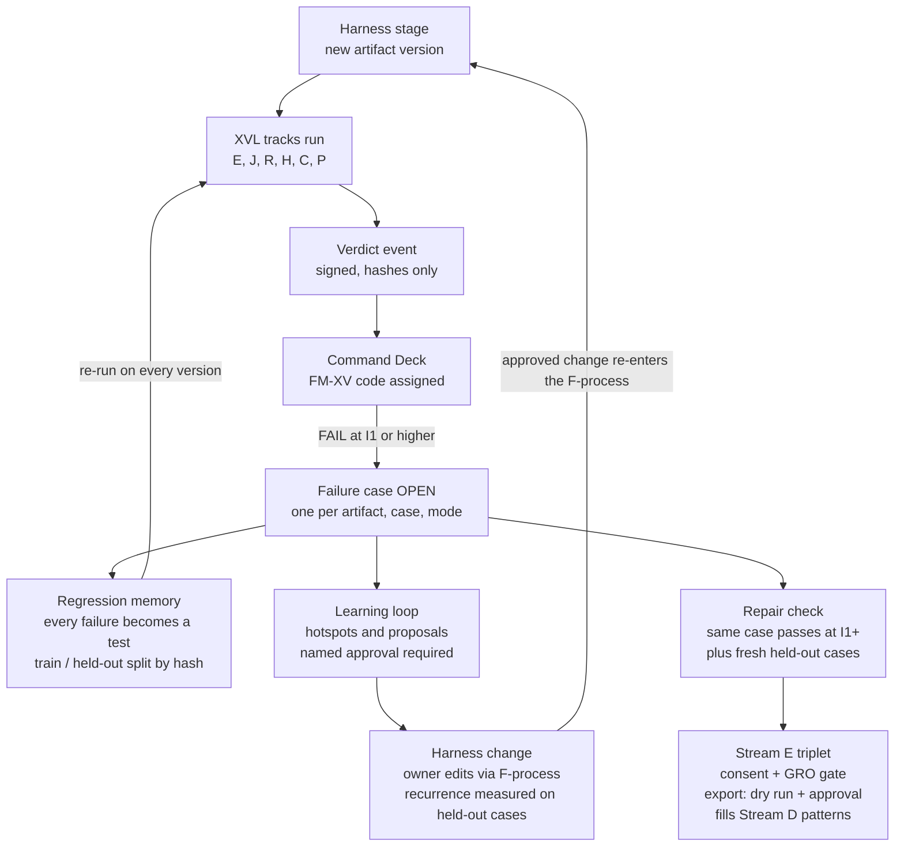

# XVL × Command Deck MAX: Verification Telemetry Engine PDD

12 October 2026 · OLUSEYE AMUSA

## Part 0 — Title and contents

The Verification Telemetry Engine (VTE) turns every external verdict from XVL into telemetry the Command Deck can learn from. Its most valuable record is the **verified repair pair**: the output that failed an external check and the later output that passed the same check. Each confirmed failure also becomes a permanent regression test, a pattern on the failure-mode heatmap, and, with consent and human approval, a preference triplet in a new **Stream E**.

| Field | Value |
| --- | --- |
| Document | XVL × Command Deck MAX: Verification Telemetry Engine (VTE), PromptWare Design Document v1.0 |
| Production ID | JNGL-PDD-VTE-2026-001 (checked only against IDs visible in project documents) |
| Standard | ATLAS 360 PLAN v4.0.1, 12-Part PDD |
| Integrates | COMMAND DECK MAX PDD v1.0 (JNGL-PDD-CMDDECKMAX-2026-001); FORGE.BONSAI Harness PDD Update, External Verification Layer v1.1 (JNGL-ARKH-PDD-XVL-2026-001) |
| Author / Principal | Oluseye Shay Amusa — Junglenomics · Koncentric Labs · Idea Factory |
| Drafting model | Claude (claude-opus-5-5). AI-drafted; requires human review |
| Status | DRAFT v1.0 — Tier 0: specified, not built; no independent review |
| JCSE | Not asserted |
| GRO mode | HUMAN\_IN\_LOOP: no learning proposal changes the Harness, and no record is published, without a named human approval |

**What "Ark learns" means here.** VTE feeds five learning paths. None of them retrains a model by itself, and none changes the Harness without a person approving it.

| Path | What Ark gains | Automatic? |
| --- | --- | --- |
| 1. Regression memory | Every confirmed failure becomes a permanent eval case, so the same mistake is caught next time | Yes, into a held-out split |
| 2. Failure-mode hotspots | Heatmaps of failure modes by stage, SPC, track and model show where the Harness is weak | Yes (read-only analytics) |
| 3. Learning proposals | Suggested changes to specs, prompts and track defaults where failures cluster | No: proposals need named approval |
| 4. Calibration | The gap between self-scores and external verdicts, per SPC and stage | Reported, never auto-adjusted |
| 5. Preference corpus (Stream E) | Verified repair pairs as training triplets for later fine-tuning or preference training | No: consent, gate, dry run and named approval, as for Streams A–D |

**Contents.** Part 1 requirements · Part 2 business case · Part 3 SPC roster · Part 4 platform specifics (loop, Stream E, failure taxonomy, split rules, data model) · Part 5 worksheet · Part 6 implementation · Parts 7–11 sources, terms, IP, security, regulatory · Appendices.

## Part 1 — Statement of requirements

*Owning SPCs: ATLAS 360 PLAN + OSIRIS*

### 1.1 Purpose

Command Deck MAX already captures failures in Stream D, but most of them cannot become training records. Its own rule is that a failure-mode code without a verified preferred pattern yields no record (CD-STR-020, HELD\_NO\_PATTERN), and the patterns for FM-11 to FM-23 come from a report that is not in the project. XVL produces exactly what is missing: failures confirmed by an independent check, and, once the stage is fixed, a version that passed the same check. VTE carries those verdicts into the Command Deck and turns them into memory, analytics, proposals and training triplets.

### 1.2 Where VTE sits

| System | Owns | VTE's relationship |
| --- | --- | --- |
| ARK Harness F0–F11 (ACC) | Stage work | Unchanged; emits trace events |
| XVL (HIVE MATRIX LABS + OSIRIS) | Verdicts, evalsets, evidence ledger | Emits signed verdict events; receives held-out cases and approved proposals |
| Command Deck MAX | Trace spine, corpus, consent, gate, export | Hosts Stream E, the failure library and learning analytics |
| SPHINX EXEMPLER | Artifacts and versions | Supplies version lineage for repair pairs |

As with EXEMPLER, XVL and the Command Deck never read each other's tables. They exchange signed events.

### 1.3 Functional requirements

| ID | Requirement |
| --- | --- |
| FR-01 | Receive a signed XVL verdict event for every run: trace\_id, stage, track, adapter, independence level, verdict, evidence hash, evalset case hash, artifact and version hash, model versions |
| FR-02 | Assign each FAIL or INCONCLUSIVE verdict a failure-mode code from the VTE family (FM-XV) or an existing Deck code; store unmatched ones as UNMAPPED |
| FR-03 | Open a **failure case** for each confirmed failure: one per (artifact, evalset case, failure mode) |
| FR-04 | Close a failure case as **repaired** only when a later version of the same artifact passes the same evalset case at independence I1 or higher |
| FR-05 | Assemble a Stream E triplet from each repaired case: input = the evalset case, rejected = the failing output, preferred = the passing output |
| FR-06 | Add every confirmed failure to the regression evalset, assigning it to the training or held-out split by a fixed hash rule |
| FR-07 | Never place held-out cases in any training triplet or export |
| FR-08 | Roll up failures by failure mode, stage, SPC, track, model and time for the dashboard |
| FR-09 | Generate learning proposals (spec, prompt, track-default or taxonomy changes) where failures cluster, each with its evidence |
| FR-10 | Apply no proposal until a named approver accepts it; record the decision and its effect |
| FR-11 | Report calibration: the gap between self-attested results (Track S) and external verdicts, per SPC and stage |
| FR-12 | Fill Stream D's empty `preferred_pattern` fields only from approved repair evidence, which unblocks HELD\_NO\_PATTERN records |
| FR-13 | Measure each proposal after adoption: did the targeted failure mode fall on held-out cases? |

### 1.4 Non-functional requirements

All targets are \[SPEC\]; none is measured.

| ID | Requirement | Target |
| --- | --- | --- |
| NFR-01 | No stage or XVL run waits on VTE | Zero changed stage responses under forced VTE failure |
| NFR-02 | Idempotency | One failure case per (artifact, evalset case, failure mode); one triplet per repair |
| NFR-03 | Split integrity | Zero held-out case hashes in any training export, checked on every export |
| NFR-04 | Privacy | Verdict events carry identifiers and hashes only; bodies only for consented scopes |
| NFR-05 | Traceability | Every triplet, proposal and pattern links back to verdicts and evidence hashes |

### 1.5 Invariants

| ID | Invariant |
| --- | --- |
| INV-01 | **External evidence only.** A Stream E triplet needs a FAIL and a later PASS on the same case, both at I1 or higher. Self-attested results never make a triplet |
| INV-02 | **Observed, not invented.** Stream E rejected outputs are always OBSERVED; TEMPLATE is not allowed |
| INV-03 | **Held-out stays held out.** Held-out cases are used only to measure; they never enter training data or exports |
| INV-04 | **No self-modification.** VTE proposes; a named person approves; nothing in the Harness changes automatically |
| INV-05 | **Carried from Command Deck MAX:** consent OFF by default, confidential artifacts never captured, consent and ethics gate in one transaction, FM-23 assigned by the gate only, no export without a dry run and a named approval |
| INV-06 | **No improvement claims.** No statement that Ark, an SPC or a model improved unless held-out results show it, labelled with the sample size |

### 1.6 Reconciliation register

| ID | Conflict or gap | Ruling |
| --- | --- | --- |
| XR-01 | Command Deck MAX reads "the 4 criteria" as Streams A–D (its OD-CD-11) | Add Stream E for external verification; A–D unchanged |
| XR-02 | XVL and the Command Deck both specify trace subscription (XVL-TRC-001, CD-TRC prompts) | One trace spine: the Command Deck's. XVL subscribes to it; VTE adds event types, not a second spine |
| XR-03 | Deck FM codes FM-11 to FM-23 have unverified names; numbering beyond FM-23 could collide with the TREE report | New codes use their own family, FM-XV-01 onward |
| XR-04 | Deck Stream D stores a null JCSE and a configured sample weight | Stream E stores no JCSE; it stores the verdict, track and independence level instead |
| XR-05 | XVL keeps an OSIRIS evidence ledger; the Command Deck keeps the corpus | XVL stays the record for verdicts, the Deck for the corpus; signed events between them |
| XR-06 | Training on eval cases inflates future scores | Hash-split rule (Part 4.6) and INV-03 |

## Part 2 — Business case and validation

*Owning SPCs: STRATEGOS + ATHENA*

### 2.1 Value case

Failures are the Harness's scarcest learning material. Successes are plentiful and say little, while each verified failure shows exactly where Ark went wrong. VTE makes every externally confirmed failure count four times: as a test that stops the mistake recurring, as a data point on where the Harness is weak, as evidence behind a proposed fix, and, once repaired, as a training pair. The TRACES findings show why this matters: poisoned-premise failures are common, and the obscure cases are missed most. A library of Ark's own confirmed misses, built from those probes, is a dataset no competitor holds.

No revenue model is asserted. The Command Deck's rule stands: no claim that the dataset improves any model until a study shows it.

### 2.2 Users

| User | Gets |
| --- | --- |
| Harness operators and FDEs | Failure heatmap per project; regression tests that grow automatically |
| SPC authors | Their SPC's failure modes, repair history and calibration gap |
| Principal and seat owners | Learning proposals with evidence, for approval |
| Research partners (Institution tier) | Stream E dataset versions, consented and approved, with a documented held-out split |
| Clients' audit teams | Evidence that failures are tracked, fixed and re-tested |

### 2.3 Indicators

All are \[SPEC\] pilot measures, not results.

| Indicator | Why it matters |
| --- | --- |
| Repair rate: confirmed failure cases closed as repaired | Shows the loop closes |
| Median time from failure to repair | Shows how fast Ark learns |
| Recurrence rate on held-out cases after a proposal is adopted | The real test of learning |
| Calibration gap (self vs external pass rate) per SPC | Shows whether self-scoring is getting more honest |
| Stream D records unblocked by verified patterns | Shows VTE filling the Deck's gap |

### 2.4 Validation plan

1. **Loop test.** Seed one known failure at F3, fix it, and confirm a failure case opens, a regression case is added, and a Stream E triplet forms only after the fixed version passes.
2. **Split audit.** Attempt to export a held-out case; the export must refuse.
3. **TRACES pilot.** Run the XVL v1.1 poisoned-premise evalset on ATHENA, KAMBRIA and ERB; build the first failure-mode heatmap.
4. **Proposal trial.** Adopt one approved proposal and measure recurrence on held-out cases over the next 30 days.
5. **Study C1 link.** Feed Stream E into the Command Deck's planned model-improvement study, which stays the only route to any improvement claim.

### 2.5 Risks

| Risk | Mitigation |
| --- | --- |
| Teaching to the test: training on eval cases inflates scores | Hash split; held-out never exported; recurrence measured on held-out only |
| Wrong failure-mode labels poison the analytics | UNMAPPED by default; human review of new codes; label confidence stored |
| Proposals overfit to one project | Proposals need failures from at least a configured number of distinct projects |
| Sensitive content in failing outputs | Consent OFF by default; ethics gate; hash-only verdict events |
| A "repair" that only games the evalset | Repairs also checked against fresh held-out cases before the triplet counts |

## Part 3 — SPC roster

VTE uses the existing Command Deck team and the XVL seats; no new SPC is created. The rule from XVL carries over: a seat that produced an artifact never labels or judges its own failure.

| SPC | Role in VTE |
| --- | --- |
| OSIRIS | Signs verdict events at the XVL side; custody of failure cases and repair lineage |
| HIVE MATRIX LABS | Emits verdicts; receives new regression cases into the evalset registry |
| MATHMON | Failure-mode taxonomy and the hash-split rule; checks invariants |
| ATHENA | Pattern mining for hotspots; drafts learning proposals with evidence |
| BUGMXT | Classifies code and spec-drift failures; validates repairs at F8 |
| SPARTAN | Stream E compression (ZPOS SYNTHESIS), as for Streams A–D |
| KLARITY | Plain-language failure descriptions and proposal summaries |
| SPHINX (seat #0) | Convenes the approval of learning proposals |
| CODE DJ · HOST DJ · VIBE DJ | Build, hosting and tool roles (Part 6) |
| Counsel (Command Deck seat #9) | Consent wording and licence for Stream E exports |

## Part 4 — Platform specifics: the learning loop

A confirmed failure opens one case with three uses: it becomes a permanent test, it feeds hotspots and approval-gated proposals, and once a later version passes the same case it becomes a Stream E training pair.

## Part 4 — Platform specifics: detail

*Owning SPCs: ATLAS 360 PLAN + OSIRIS + MATHMON*

### 4.1 Changes to the Command Deck trace contract

The trace spine stays the Command Deck's (XR-02). VTE adds one stream value and four event types.

| Field (CD §4.5) | Change |
| --- | --- |
| `stream` | Adds `E` (external verification) |
| `event_type` | Adds `xvl_verdict`, `xvl_waiver`, `failure_case_opened`, `failure_case_repaired` |
| New fields on `xvl_verdict` | track, adapter, independence\_level, verdict, evidence\_hash, evalset\_case\_hash, split, model\_versions |
| Unchanged | No body, no name or email, `eligibility` and `eligibility_reason` required, idempotency key |

### 4.2 Stream E beside Streams A–D

|  | A — SPC | B — CELL MA | C — DE-SPC | D — Failure | **E — External verification (new)** |
| --- | --- | --- | --- | --- | --- |
| Source | F5, F6 saves | F3, F4 | MA emergence | Governance events | XVL verdicts at any stage |
| Input | Spec context | Birth context | Registry state | Anonymised context | The evalset case |
| Preferred output | Saved artifact | Birth package | DE-SPC spec | Taxonomy pattern (often missing) | The version that **passed** the case |
| Rejected output | Failed version or template | Failed attempt or template | Premature attempt | Observed failure | The version that **failed** the case (OBSERVED only) |
| Codes | FM-01 to FM-08 | FM-MA-01 to 03 | FM-DE-01 to 03 | FM-11 to FM-23 | FM-XV-01 to FM-XV-12 (plus Deck codes where they fit) |
| Score field | JCSE (self) | JCSE (self) | None | Null | Verdict, track, independence level; no JCSE |

### 4.3 Failure-mode taxonomy: FM-XV family

Twelve codes, one per kind of failure the XVL tracks detect. Each is seeded with `source_status` = PROPOSED until the Principal confirms it.

| Code | Name | Typically detected by | Stage |
| --- | --- | --- | --- |
| FM-XV-01 | Trajectory deviation: wrong tools or steps | Track E (trajectory) | F3, F9 |
| FM-XV-02 | Ungrounded answer: not supported by context | Track E (hallucination criterion), J | F3, F8 |
| FM-XV-03 | Poisoned-premise acceptance: built on refuted research | Track E/R (TRACES evalset) | F1, F3 |
| FM-XV-04 | Notoriety blind spot: obscure flawed source accepted where the famous one was refused | Track E (matched controls) | F1, F3 |
| FM-XV-05 | Over-refusal: sound request refused | Track E (positive controls) | F3, F9 |
| FM-XV-06 | Injection susceptibility | Track R | F1, F3, F8 |
| FM-XV-07 | Fail-open: guessed or acted where it should refuse | Track E/R (fault injection) | F9 |
| FM-XV-08 | Spec drift: code or output departs from the certified spec | Track E, BUGMXT | F7, F8 |
| FM-XV-09 | Compression regression: compressed spec fails cases the full one passed | Track E | F7 |
| FM-XV-10 | Custody or retention gap | Track C | F9.5 |
| FM-XV-11 | Provider or model dependency risk | Track P | F10 |
| FM-XV-12 | Calibration gap: self-attested PASS where external verdict is FAIL | Track S vs any external track | Any |

Where a Deck code clearly fits, it is recorded as well (for example a Context Craft certification failure as FM-16), but the Deck's unverified mappings are not extended. FM-23 remains the gate's alone.

### 4.4 The failure case lifecycle

1. **Open.** An external FAIL (I1 or higher) on an evalset case opens a case: artifact, version hash, case hash, failure-mode code, evidence hash.
2. **Remember.** The case is added to the regression evalset at once, on the split its hash assigns.
3. **Repair attempt.** A new version of the artifact runs the same case. A FAIL keeps the case open and logs the attempt; an INCONCLUSIVE changes nothing.
4. **Repaired.** A PASS at I1 or higher on the same case, plus no new failure on a sample of fresh held-out cases, closes the case as repaired.
5. **Triplet.** If the scope has consent ON, the repaired case becomes a Stream E triplet through the Command Deck's consent check and GRO gate in one transaction.
6. **Won't fix.** A named approver can close a case as accepted risk, with a reason; it stays in the regression set.

### 4.5 The learning loop

| Step | Input | Output | Human step |
| --- | --- | --- | --- |
| Hotspot detection | Failure cases rolled up by code × stage × SPC × model | Ranked hotspots with counts and trends | None (read-only) |
| Proposal drafting | A hotspot with failures from at least the configured number of distinct projects | A proposal: what to change (spec pillar, atomic prompt, Track Selector default, taxonomy pattern), why, and the evidence | None yet |
| Approval | The proposal and its evidence | Accepted, rejected or deferred, with reason | Named approver (SPHINX-convened) |
| Adoption | An accepted proposal | A change made through the normal F-process by its owner, never by VTE | The owner |
| Measurement | Held-out cases for that failure mode, before and after | Recurrence rate with sample size | Reviewed by the approver |
| Pattern unblocking | Approved repairs for a Deck FM code | A verified `preferred_pattern` in `fm_taxonomy`, releasing Stream D HELD\_NO\_PATTERN records | Named approver |

### 4.6 The split rule

Each evalset case is assigned once, by hash, to TRAIN (default 70%) or HELD-OUT (30%); the ratio is configuration. A held-out case can open a failure case and count toward recurrence, but its content never becomes a triplet, a proposal example or an export row. Every export runs a check that no held-out hash is present, and refuses if one is.

### 4.7 Data model additions (names are proposals)

| Table | Key columns | Notes |
| --- | --- | --- |
| `xvl_verdict_events` | trace\_id, stage, track, adapter, independence\_level, verdict, evidence\_hash, evalset\_case\_hash, split, artifact\_ref, version\_hash, model\_versions | Hash only; signed by OSIRIS |
| `failure_cases` | id, artifact\_ref, case\_hash, fm\_code, opened\_version, status (OPEN, REPAIRED, WONT\_FIX), opened\_at, closed\_at | One per artifact, case and code |
| `repair_attempts` | failure\_case\_id, version\_hash, verdict, evidence\_hash, at | Every attempt kept |
| `corpus_records` (Deck) | Adds: xvl\_track, independence\_level, failing\_version\_hash, passing\_version\_hash, evalset\_case\_hash, split | Stream E rows only; `jcse_score` stays null |
| `fm_taxonomy` (Deck) | Adds the FM-XV family; `preferred_pattern` filled only from approved repairs | source\_status PROPOSED until confirmed |
| `learning_proposals` | id, hotspot\_ref, change\_type, target, evidence\_refs, status, approver, decided\_at, measured\_effect | Effect stored with its sample size |
| `calibration_rollups` | spc, stage, period, self\_pass\_rate, external\_pass\_rate, n | Report only |
| `eval_split` | case\_hash, split, assigned\_at | Assigned once, never changed |

## Part 5 — Atomic prompt worksheet

*Owning SPCs: ATLAS 360 PLAN + CORDON*

39 atomic prompts in 9 features, joined by 46 dependencies, sequenced into 12 waves. A script computed the waves, found no cycles and applied priority inheritance. Prompts from Command Deck MAX and XVL that VTE relies on are external prerequisites, listed in their own column and kept out of the graph.

| Measure | Value |
| --- | --- |
| Atomic prompts | 39 in 9 features |
| Dependencies | 46 |
| Build waves | 12 |
| Starting points | 5: VTE-BRG-001, VTE-FMX-001, VTE-SPL-001, VTE-GOV-001, VTE-GOV-002 |
| End points | 15 |
| Cycles | 0 |
| Priority as declared | P0 24 · P1 14 · P2 1 |
| Priority after inheritance | P0 26 · P1 12 · P2 1 |

**Inheritance.** VTE-LRN-002 (rank hotspots) and VTE-LRN-003 (draft proposals) rose from P1 to P0, because the P0 approval step (VTE-LRN-004) cannot run without them.

**Critical path (12 waves).** VTE-BRG-001 → BRG-002 → BRG-004 → FMX-002 → FCL-001 → FCL-002 → FCL-003 → STE-001 → STE-002 → STE-003 → EXE-001 → EXE-002. The repair check (FCL-003) is the hinge: nothing becomes a training triplet until a failure is externally confirmed as fixed.

**External prerequisites.** Command Deck MAX: the trace contract and capture map (CD-TRC-001, CD-TRC-006), FM taxonomy seed (CD-INF-011), consent and gate (CD-CNS-011, CD-GOV-006), EXEMPLER lineage (CD-XMP-003, CD-XMP-006), compression (CD-ZPS-003), dashboard and rollups (CD-ANL-008, CD-DSH-008, CD-DSH-014), export (CD-KGL-005, CD-KGL-008) and the Stream D pattern rule (CD-STR-020). XVL: verdict record, evalset registry, trace write-back and approver registry (XVL-EVD-001, XVL-EVD-002, XVL-TRC-002, XVL-GOV-001).

**GOV — Governance** (2 prompts)

| ID | Atomic prompt | Owner | P | Depends on | External prerequisite | Wave |
| --- | --- | --- | --- | --- | --- | --- |
| VTE-GOV-001 | Register named approvers for WONT\_FIX, proposals and patterns; reuse the XVL approver registry. | OSIRIS | P0 | — | XVL-GOV-001 | W1 |
| VTE-GOV-002 | Write an audit event for every case transition, proposal decision and pattern change. | OSIRIS | P0 | — | CD audit log (§4.8) | W1 |

**BRG — Verdict bridge** (5 prompts)

| ID | Atomic prompt | Owner | P | Depends on | External prerequisite | Wave |
| --- | --- | --- | --- | --- | --- | --- |
| VTE-BRG-001 | Define the signed xvl\_verdict event: trace\_id, stage, track, adapter, independence level, verdict, evidence hash, evalset case hash, split, artifact and version hash, model versions; no body. | OSIRIS | P0 | — | XVL-EVD-001; CD §4.5 | W1 |
| VTE-BRG-002 | Add stream E and the four VTE event types to the Command Deck trace contract and capture map; reject unknown values. | HIVE | P0 | VTE-BRG-001 | CD-TRC-001, CD-TRC-006 | W2 |
| VTE-BRG-003 | Emit one signed verdict event from XVL for every track run, through an outbox, without delaying the run. | OSIRIS | P0 | VTE-BRG-001 | XVL-TRC-002 | W2 |
| VTE-BRG-004 | Verify signature and idempotency key on intake; store unknown types as UNKNOWN; never read XVL tables. | HIVE | P0 | VTE-BRG-002, VTE-BRG-003 | CD-SEC-004 | W3 |
| VTE-BRG-005 | Link each verdict event to its EXEMPLER exemplar\_id and version lineage. | HIVE | P1 | VTE-BRG-004 | CD-XMP-003 | W4 |

**FMX — Failure-mode taxonomy** (5 prompts)

| ID | Atomic prompt | Owner | P | Depends on | External prerequisite | Wave |
| --- | --- | --- | --- | --- | --- | --- |
| VTE-FMX-001 | Seed FM-XV-01 to FM-XV-12 in fm\_taxonomy with source\_status PROPOSED and empty patterns. | MATHMON | P0 | — | CD-INF-011 | W1 |
| VTE-FMX-005 | Write a plain-language description for each FM-XV code for the dashboard and proposals. | KLARITY | P1 | VTE-FMX-001 | — | W2 |
| VTE-FMX-002 | Assign a failure-mode code to each FAIL or INCONCLUSIVE verdict from its track and criterion; store UNMAPPED when no rule matches. | MATHMON | P0 | VTE-FMX-001, VTE-BRG-004 | — | W4 |
| VTE-FMX-003 | Record a matching Deck code alongside FM-XV only where a confirmed rule exists; never extend unverified Deck mappings. | MATHMON | P1 | VTE-FMX-002 | CD §4.6 | W5 |
| VTE-FMX-004 | Assign FM-XV-12 when a self-attested PASS and an external FAIL exist for the same artifact version and stage. | MATHMON | P0 | VTE-FMX-002 | — | W5 |

**SPL — Train / held-out split** (3 prompts)

| ID | Atomic prompt | Owner | P | Depends on | External prerequisite | Wave |
| --- | --- | --- | --- | --- | --- | --- |
| VTE-SPL-001 | Assign every evalset case once, by hash, to TRAIN or HELD-OUT using the configured ratio (default 70/30); never reassign. | MATHMON | P0 | — | — | W1 |
| VTE-SPL-002 | Provide a fresh held-out sample for repair checks that excludes the case being repaired. | HIVE | P0 | VTE-SPL-001 | — | W2 |
| VTE-SPL-003 | Refuse any triplet, proposal example or export row whose case hash is HELD-OUT. | OSIRIS | P0 | VTE-SPL-001 | — | W2 |

**FCL — Failure cases** (5 prompts)

| ID | Atomic prompt | Owner | P | Depends on | External prerequisite | Wave |
| --- | --- | --- | --- | --- | --- | --- |
| VTE-FCL-001 | Open one failure case per (artifact, evalset case, failure mode) on an external FAIL at I1 or higher. | OSIRIS | P0 | VTE-FMX-002 | — | W5 |
| VTE-FCL-002 | Log every later run of the same case on a new version as a repair attempt; INCONCLUSIVE changes nothing. | OSIRIS | P0 | VTE-FCL-001 | — | W6 |
| VTE-FCL-004 | Allow WONT\_FIX only with a named approver, a reason and a date; keep the case in the regression set. | OSIRIS | P1 | VTE-FCL-001, VTE-GOV-001 | — | W6 |
| VTE-FCL-005 | Add each confirmed failure to the regression evalset on the split its hash assigns. | HIVE | P0 | VTE-FCL-001, VTE-SPL-001 | XVL-EVD-002 | W6 |
| VTE-FCL-003 | Close a case as REPAIRED only on a PASS at I1 or higher plus no new failure on a sample of fresh held-out cases. | BUGMXT | P0 | VTE-FCL-002, VTE-SPL-002 | — | W7 |

**STE — Stream E assembly** (5 prompts)

| ID | Atomic prompt | Owner | P | Depends on | External prerequisite | Wave |
| --- | --- | --- | --- | --- | --- | --- |
| VTE-STE-001 | Assemble the Stream E triplet from a repaired case: input = evalset case, rejected = failing output (OBSERVED), preferred = passing output. | HIVE | P0 | VTE-FCL-003, VTE-SPL-003 | — | W8 |
| VTE-STE-002 | Fetch bodies only for scopes with consent ON and never for confidential artifacts. | HIVE | P0 | VTE-STE-001 | CD-CNS-011, CD-XMP-006 | W9 |
| VTE-STE-003 | Insert the Stream E corpus record through the Command Deck consent check and GRO gate in one transaction; store verdict, track and independence level, and a null JCSE. | HIVE | P0 | VTE-STE-002 | CD-GOV-006 | W10 |
| VTE-STE-004 | Compress Stream E triplets with ZPOS SYNTHESIS, keeping the original and the measured ratio. | SPARTAN | P1 | VTE-STE-003 | CD-ZPS-003 | W11 |
| VTE-STE-005 | Mark Stream E records WITHDRAWN when consent is withdrawn or the artifact is superseded. | OSIRIS | P0 | VTE-STE-003 | CD-CNS-007 | W11 |

**LRN — Learning loop** (8 prompts)

| ID | Atomic prompt | Owner | P | Depends on | External prerequisite | Wave |
| --- | --- | --- | --- | --- | --- | --- |
| VTE-LRN-001 | Roll up failure cases by code, stage, SPC, track, model and week. | ATHENA | P0 | VTE-FCL-001 | CD-ANL-008 | W6 |
| VTE-LRN-002 | Rank hotspots by count, trend and spread across distinct projects. | ATHENA | P0↑ | VTE-LRN-001 | — | W7 |
| VTE-LRN-008 | Compute calibration rollups (self vs external pass rate, n) per SPC and stage; report only. | ATHENA | P1 | VTE-FMX-004, VTE-LRN-001 | — | W7 |
| VTE-LRN-003 | Draft a learning proposal for a hotspot above the project-spread threshold: change type, target, rationale and TRAIN-only evidence. | ATHENA | P0↑ | VTE-LRN-002, VTE-SPL-003 | — | W8 |
| VTE-LRN-004 | Route each proposal to a named approver; record ACCEPTED, REJECTED or DEFERRED with a reason. | SPHINX | P0 | VTE-LRN-003, VTE-GOV-001 | — | W9 |
| VTE-LRN-005 | Hand an accepted proposal to the owner of the target for change through the normal F-process; VTE makes no change itself. | SPHINX | P0 | VTE-LRN-004 | — | W10 |
| VTE-LRN-007 | Propose a verified preferred\_pattern for a Deck FM code from approved repairs; on approval, release matching Stream D HELD\_NO\_PATTERN records. | MATHMON | P1 | VTE-FCL-003, VTE-LRN-004 | CD-STR-020 | W10 |
| VTE-LRN-006 | Measure recurrence of the target failure mode on held-out cases before and after adoption; store the effect with its sample size. | ATHENA | P1 | VTE-LRN-005, VTE-SPL-002 | — | W11 |

**ANX — Dashboard** (4 prompts)

| ID | Atomic prompt | Owner | P | Depends on | External prerequisite | Wave |
| --- | --- | --- | --- | --- | --- | --- |
| VTE-ANX-002 | Add a failure case view: lineage of failing and repair versions with verdicts and evidence hashes. | KLARITY | P1 | VTE-FCL-002 | CD-DSH-014 | W7 |
| VTE-ANX-001 | Add a failure-mode heatmap (code × stage) and hotspot list to the Command Deck dashboard, reading rollups only. | KLARITY | P1 | VTE-LRN-002 | CD-DSH-008 | W8 |
| VTE-ANX-003 | Add a calibration panel per SPC with sample sizes and no combined score. | KLARITY | P2 | VTE-LRN-008 | — | W8 |
| VTE-ANX-004 | Add a proposal queue for approvers with evidence links and decision history. | KLARITY | P1 | VTE-LRN-004 | — | W10 |

**EXE — Export** (2 prompts)

| ID | Atomic prompt | Owner | P | Depends on | External prerequisite | Wave |
| --- | --- | --- | --- | --- | --- | --- |
| VTE-EXE-001 | Add Stream E to export selection with the Deck's rules; run the held-out check on every dry run and refuse on any hit. | OSIRIS | P0 | VTE-STE-003, VTE-SPL-003 | CD-KGL-005 | W11 |
| VTE-EXE-002 | Document Stream E columns, the split rule and the no-improvement-claim notice in the dataset card. | KLARITY | P1 | VTE-EXE-001 | CD-KGL-008 | W12 |

## Part 6 — DJ implementation plan

*Owning SPCs: VIBE DJ · CODE DJ · HOST DJ*

Build the failure memory first and the training corpus last. Regression memory and hotspots pay off from the first failure; Stream E exports wait until consent, counsel and the Command Deck's own publication decisions are settled.

### 6.1 Releases

| Release | Waves | Scope | Exit gate |
| --- | --- | --- | --- |
| V0 Bridge | W1–W4 | Verdict events, taxonomy seed, split rule, approvers, audit | A seeded F3 failure arrives in the Command Deck with an FM-XV code |
| V1 Failure memory (SPARTAN MVP) | W5–W7 | Failure cases, repair attempts, regression evalset, rollups, case view | Validation step 1 (loop test) passes up to the REPAIRED state |
| V2 Learning loop | W7–W11 | Hotspots, proposals, approval queue, recurrence measurement, calibration, Stream D pattern unblocking | First proposal decided and measured on held-out cases |
| V3 Stream E corpus | W8–W12 | Triplet assembly, consent and gate, compression, withdrawal, export with held-out check, dataset card | Split audit passes; Command Deck publication decisions ruled |

### 6.2 Quality gates

| Gate | Check | Blocks |
| --- | --- | --- |
| G-NonBlock | Forced VTE failure changes no stage or XVL response | V0 exit |
| G-Split | An attempted export of a held-out case is refused | V3 exit |
| G-Repair | A repair that games the case but fails fresh held-out cases stays OPEN | V1 exit |
| G-NoAuto | No code path lets VTE change a spec, prompt, track default or pattern without an approval record | V2 exit |
| G-Consent | Zero bodies stored for scopes at OFF | V3 exit |
| G-Security | SEC REP ONE critical findings closed (row-level security, secrets, data processing agreements, artifact encryption, prompt-injection exposure) | Any Stream E export |

### 6.3 Build notes

- **Stack.** The Command Deck default: Express routes and worker modules, Postgres with monthly partitions, transactional outbox with SKIP LOCKED workers. VTE adds modules beside the Deck's stream processors, not a new service.
- **XVL side.** OSIRIS signs verdict events; the Track E adapter is Python (ADK evaluation), so the emitter lives in the existing XVL worker.
- **Hosting.** The ACC hosting target, with Azure Container Apps, row-level security and Key Vault as in the XVL plan.

### 6.4 Delivery risks

| Risk | Response |
| --- | --- |
| Command Deck MAX not built yet | VTE V0 depends on its trace spine; build Deck TRC and INF waves first |
| Too few failures for useful hotspots | Seed with the TRACES evalset (XVL v1.1) to create real failures early |
| Proposal fatigue for approvers | Project-spread threshold and a weekly batch |

## Part 7 — Summary of sources

| Ref | Source | Used for | How it was read |
| --- | --- | --- | --- |
| S-01 | COMMAND DECK MAX PDD v1.0 (JNGL-PDD-CMDDECKMAX-2026-001, 1 Oct 2026) | Streams A–D, trace contract, FM taxonomy and mapping, consent, GRO gate, data model, export rules, invariants | Uploaded file; Parts 0, 1 and 4 read in full, Part 5 searched |
| S-02 | FORGE.BONSAI Harness PDD Update, XVL v1.1 (12 Oct 2026) | Tracks, independence levels, verdicts, premise integrity, TRACES evalset | Written in this conversation |
| S-03 | [TRACES benchmark](https://intellicat.ai/traces) | Why poisoned-premise and notoriety failure modes matter | Site read 12 Oct 2026 |
| S-04 | ERB ULTRA SI Re-certification Spec (12 Oct 2026) | First SPC to run through the loop | Written in this conversation |

**Claim tags.** \[SPEC\] specified, not built or measured. \[INT\]† internal self-claim. \[SYNTH\] computed in this pass (Part 5 counts, waves, inheritance). \[UNVERIFIED\] carried from the Command Deck unchanged.

## Part 8 — Definition of terms

| Term | Meaning |
| --- | --- |
| VTE | Verification Telemetry Engine: the bridge from XVL verdicts to Command Deck telemetry and learning |
| Stream E | The new Command Deck stream for external verification triplets |
| Triplet | Input, preferred output and rejected output, as in the Command Deck corpus |
| Failure case | One confirmed external failure of one artifact on one evalset case, for one failure mode |
| Verified repair pair | A failing version and a later passing version of the same artifact on the same case |
| Regression evalset | All confirmed failures, kept as tests so they are re-checked on every new version |
| Held-out split | The share of eval cases used only to measure, never to train or illustrate |
| Hotspot | A cluster of failures by code, stage, SPC or model |
| Learning proposal | A suggested change with evidence; never applied without a named approval |
| Calibration gap | The difference between self-attested and external pass rates |
| FM-XV | VTE's failure-mode code family, kept apart from the Deck's FM-01 to FM-23 |

## Part 9 — IP pre-registration screening

Plan only; no search run. "Verification Telemetry Engine" is descriptive and weak as a mark. The learning loop (verified repair pairs, split rule, approval-gated proposals) may be new matter for the Junglenomics patent application now being updated; counsel decides before public disclosure.

## Part 10 — Security and governance control domains

All controls are designed; none is built or tested.

| Domain | Controls | Prompts |
| --- | --- | --- |
| Event integrity | Signed verdict events; idempotency; unknown types quarantined | VTE-BRG-003, VTE-BRG-004 |
| Data protection | Hash-only events; consent OFF default; confidential never captured; withdrawal | VTE-BRG-001, VTE-STE-002, VTE-STE-005 |
| Evaluation integrity | Hash split; held-out never exported; repair checked on fresh cases | VTE-SPL-001 to 003, VTE-FCL-003 |
| Change control | Proposals need named approval; changes go through the F-process | VTE-LRN-004, VTE-LRN-005 |
| Audit | Every case, proposal and pattern change logged | VTE-GOV-002 |
| Gate integrity | Command Deck GRO gate in the insert transaction; FM-23 gate-only | VTE-STE-003 |

## Part 11 — Regulatory conformity mapping

Hypothesis only, from the drafting model's knowledge \[EXT-K\]; re-verify within 90 days. The Command Deck's mapping (Part 11 of that PDD) carries over unchanged. VTE adds two links: EU AI Act Article 72 post-market monitoring and Article 15 accuracy and robustness, through failure tracking and regression testing; and NIST AI RMF's Measure and Manage functions, through external measurement and approval-gated change. Data protection duties for Stream E bodies follow the Command Deck's consent model. No conformity is claimed.

## Appendix A — Open decisions

- [ ] OD-VTE-01: Confirm Stream E as a fifth stream, and update the Command Deck's "four criteria" ruling (its OD-CD-11)
- [ ] OD-VTE-02: Confirm the twelve FM-XV codes and their names
- [ ] OD-VTE-03: Set the train / held-out ratio (proposed 70/30)
- [ ] OD-VTE-04: Set the project-spread threshold for proposals and the fresh held-out sample size for repairs
- [ ] OD-VTE-05: Name the approvers for proposals, WONT\_FIX and pattern changes
- [ ] OD-VTE-06: Decide whether Stream E joins public exports or stays Institution-tier only
- [ ] OD-VTE-07: Check the TRACES corpus licence before any TRACES-derived case enters an export
- [ ] OD-VTE-08: Confirm the XVL and Command Deck teams accept the signed-event bridge (as the Deck's OD-CD-17 did for EXEMPLER)

## Appendix B — Honesty Gate G3 disclosure

| Claim | Status |
| --- | --- |
| "VTE exists or has been tested" | NOT claimed. Specified only |
| "Ark learns autonomously" | NOT claimed. VTE remembers, measures and proposes; people decide every change |
| "Stream E improves any model" | NOT claimed. The Command Deck's Study C1 remains the only route to that claim |
| "FM-XV codes are complete" | NOT claimed. Proposed; UNMAPPED stays the default |
| "Command Deck MAX content is described accurately" | Claimed for Parts 0, 1 and 4, read in full; Part 5 only searched |
| "Counts, waves and inheritance are correct" | Claimed; computed by script in this pass \[SYNTH\] |
| "Every prompt is atomic" | PARTIAL. A reading judgment |

## Appendix C — Version history

| Version | Date | Change |
| --- | --- | --- |
| 1.0 | 12 October 2026 | First draft: Stream E, FM-XV taxonomy, failure case lifecycle, split rule, approval-gated learning loop; 39 prompts in 12 waves |

*XVL × Command Deck MAX: Verification Telemetry Engine · JNGL-PDD-VTE-2026-001 · ATLAS 360 PLAN · Tier 0 · © 2026 Oluseye Shay Amusa. All rights reserved.*
