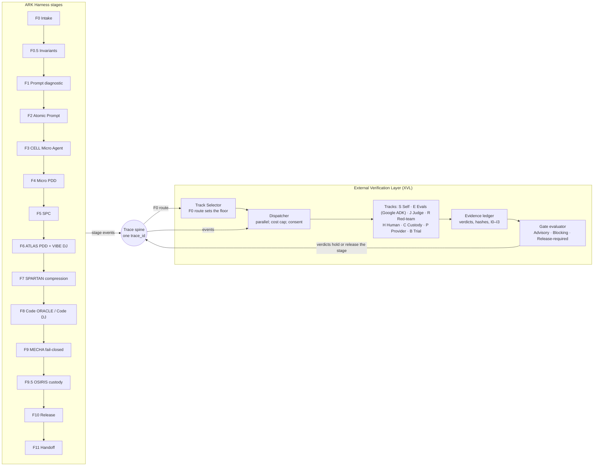

# FORGE.BONSAI Harness PDD Update: External Verification Layer

12 October 2026 · OLUSEYE AMUSA

## Part 0 — Title and contents

This update adds an External Verification Layer (XVL) that runs beside every ARK Harness stage, F0 to F11. Its Track Selector lets each user choose which outside verification tracks check their work. Google-style evals are the reference track; the layer is built so that no stage grades its own output.

| Field | Value |
| --- | --- |
| Document | FORGE.BONSAI Harness PDD Update — External Verification Layer (XVL) and Track Selector, v1.0 |
| Production ID | JNGL-ARKH-PDD-XVL-2026-001 (checked for uniqueness only against IDs visible in project documents) |
| Standard | ATLAS 360 PLAN v4.0.1, 12-Part PDD (Parts 0–11) |
| Extends | ARK Harness Omnibus PDD v4.0 (JNGL-ARKH-PDD-2026-004); COMMAND DECK MAX PDD v1.0 (trace spine); stage names from the ATLAS 360 SCAN of the ATANDA Command Centre (23 Sep 2026) |
| Inputs | "Google's New SDLC vs ARK + Context Craft" (12 Oct 2026); "Two FDEs, One Platform" (12 Oct 2026) |
| Author / Principal | Oluseye Shay Amusa — Junglenomics · Koncentric Labs · Idea Factory |
| Drafting model | Claude (claude-opus-5-5). AI-drafted; requires human review |
| Status | DRAFT v1.0 — Tier 0: specified, not built; no independent review |
| JCSE | Not asserted |
| Honesty Gate | G3. Claim tags in Part 7 |

**Contents.** Part 1 requirements · Part 2 business case · Part 3 SPC roster · Part 4 platform specifics (architecture, stage map, tracks, selector, gates) · Part 5 atomic prompt worksheet · Part 6 DJ implementation plan · Parts 7–8 sources and terms · Parts 9–11 IP, security, regulatory · Appendices A–C.

**Recommendations adopted.** Each recommendation from the two input documents becomes a requirement here.

| ID | Recommendation | Source document | Lands in |
| --- | --- | --- | --- |
| R-01 | Add a verification thread to every stage: a check written before the stage artifact, not only a gate after it | SDLC comparison | FR-02, FR-03 |
| R-02 | Check the agent's reasoning path at F3 and F9, using the trace spine as evidence | SDLC comparison | FR-07 |
| R-03 | Back the gates with external evidence; JCSE is self-assigned | SDLC comparison; FDE comparison | FR-05, INV-01 |
| R-04 | Teach and export AGENTS.md as the public form of an F5 SPC | SDLC comparison | FR-10 |
| R-05 | F0 routes prototypes to a light path | SDLC comparison | FR-04 (Prototype Light profile) |
| R-06 | Disambiguate Google's "conductor mode" from ARK's Conductor meta-skill | SDLC comparison | Part 8; XR-03 |
| R-07 | Close the Command Deck trace hooks that learners touch | SDLC comparison | Dependency D-01 |
| R-08 | Build ground-truth evals from human decisions (e.g. moderator history) | FDE comparison | Track E, FR-08 |
| R-09 | Check audit and custody retention at F9.5 | FDE comparison | Track C |
| R-10 | Flag preview-model and provider dependencies at F10 | FDE comparison | Track P |
| R-11 | Validate the Harness itself with a controlled trial, gated vs ungated | FDE comparison; ATHENA Forge Edition | Track B, Part 2.4 |
| R-12 | Track run cost per stage (CapEx/OpEx flip) | SDLC comparison | FR-09 |

## Part 1 — Statement of requirements

*Owning SPCs: ATLAS 360 PLAN + MATHMON*

### 1.1 Purpose

The ARK Harness gates are rigorous in structure but self-assessed in evidence. XVL fixes that by running independent checks in parallel with each F-stage and writing their verdicts back to the same trace. The Track Selector lets a user, or their organisation, choose how much outside verification each stage gets, within a floor set at F0.

### 1.2 Scope

**In scope.** A parallel verification lane for F0–F11; a catalogue of eight verification tracks; the Track Selector with presets and floors; gate modes; verdict and evidence records; an Evidence Pack export; adapters for external eval tools, with Google's ADK evaluation as the reference adapter.

**Out of scope.** Building or hosting third-party eval tools; any certification or accreditation claim; payments for third-party verifiers; changes to stage content itself.

### 1.3 Functional requirements

| ID | Requirement |
| --- | --- |
| FR-01 | Subscribe to every F0–F11 trace event under its `trace_id` and start the tracks selected for that stage |
| FR-02 | Let users choose tracks per stage and per project through the Track Selector, from presets or one by one |
| FR-03 | Verification first: where a stage's Track E gate is Blocking, its evalset must be registered and hashed before the stage artifact is submitted |
| FR-04 | Set a profile floor from the F0 route: Prototype Light, Standard or Regulated |
| FR-05 | Record each verdict with track, independence level, verifier identity, evidence hash and time; update the stage's conformity state |
| FR-06 | Refuse to count a check as external when the verifier is the producing model in the same session |
| FR-07 | Run reasoning-path (trajectory) checks at F3 and F9 against the expected tool calls and steps |
| FR-08 | Build ground-truth evalsets from real human decisions (approvals, rejections, moderator outcomes) |
| FR-09 | Report tokens, calls, duration and cost per stage and per track; report only, never gate |
| FR-10 | Export an F5 SPC as an AGENTS.md file and its mirrors, and verify the round trip |
| FR-11 | Allow waivers only with a named approver, a reason and an expiry date |
| FR-12 | Produce an Evidence Pack per project: tracks run, verdicts, waivers, conformity state per stage |
| FR-13 | Accept new tracks through a registered adapter interface |
| FR-14 | Fail closed: a track that errors or times out returns INCONCLUSIVE, and a Blocking gate holds |

### 1.4 Non-functional requirements

All targets are \[SPEC\]; none is measured.

| ID | Requirement | Target |
| --- | --- | --- |
| NFR-01 | Parallelism | Advisory tracks add no wait to a stage; Blocking tracks wait only on their own results |
| NFR-02 | Replayability | Every verdict records model versions and evalset hash so it can be re-run |
| NFR-03 | Privacy | External tracks receive hashes or redacted payloads unless the data owner consents to more |
| NFR-04 | Cost control | Per-project monthly cap on verification spend; tracks pause at the cap and report it |
| NFR-05 | Accessibility | Track Selector meets WCAG 2.2 AA; usable by non-technical learners |
| NFR-06 | Traceability | 100% of verdicts link to a trace event and an evidence hash |

### 1.5 Invariants

| ID | Invariant |
| --- | --- |
| INV-01 | **No stage grades its own work.** Self-attested results are recorded but never count as external evidence |
| INV-02 | **Inconclusive is not a pass.** Errors, timeouts and missing evidence never produce PASS |
| INV-03 | **Floors only go up.** Users may add tracks above the F0 floor; only the named Principal may lower it, with a logged reason |
| INV-04 | **No evidence, no verdict.** A verdict without an evidence hash is rejected |
| INV-05 | **Scores stay separate.** Track verdicts are never folded into one composite, and JCSE stays labelled self-assigned |
| INV-06 | **Custody holds.** No content leaves custody to an external track beyond the consent level its owner set |
| INV-07 | **Labels are earned.** "Evidence-Backed" needs a pass at independence I1 or higher; "Independently Audited" needs I3 by an outside auditor |

### 1.6 Reconciliation register

| ID | Issue found | Ruling |
| --- | --- | --- |
| XR-01 | Some documents describe the Harness as F0–F9.5; the ATLAS 360 SCAN lists 14 stages, F0–F11 with F0.5 and F9.5 | Follow the SCAN |
| XR-02 | Harness Omnibus v10 defines F9 as post-deployment math validation; the SCAN defines it as the MECHA fail-closed floor | Follow the SCAN; flag for the Principal |
| XR-03 | Google's "conductor mode" (real-time pairing) collides with ARK's Conductor meta-skill (quality focus) | Use "pairing mode" for Google's term in all XVL text |
| XR-04 | An older FORGE pipeline listing orders stages differently (F3 compression, F4 portability) | Follow the SCAN |
| XR-05 | "Google AI-driven evals" names a method from the whitepaper plus Google's eval tools, not a Google certification | XVL claims no Google endorsement; Track E is "eval-as-contract, Google reference adapter" |

## Part 2 — Business case, users and validation

*Owning SPCs: STRATEGOS + ATHENA*

### 2.1 Value case

XVL turns the Harness's biggest weakness into its selling point. Today a buyer must trust ATANDA's own scores; with XVL, each stage can carry evidence from tools and people ATANDA does not control. That is what the Google SDLC comparison and the FDE simulation both concluded: Google's eval discipline inside an ATANDA delivery structure is stronger than either alone.

### 2.2 Users

| User | Need | What XVL gives them |
| --- | --- | --- |
| Context Craft learner (non-technical) | Know whether their spec is actually good | Presets that pick sensible tracks; plain verdicts per stage |
| FDE or engineer | Fast, tested delivery | Track E evalsets in CI; trajectory checks; cost report |
| Client compliance or audit team | Evidence they can file | Evidence Pack; conformity state per stage; waiver log |
| Organisation admin | Consistent standards across teams | Organisation floors and default profiles |
| ATANDA (as vendor) | Proof the method works | Track B controlled trials across many projects |

### 2.3 Indicators

All are \[SPEC\] pilot targets, not results.

| Indicator | Why it matters | Pilot target |
| --- | --- | --- |
| Share of gates with at least one I1+ pass | Moves the Harness off self-assessment | Tracked; baseline in pilot |
| Disagreement rate between self-attested and external verdicts | Shows where self-scoring is optimistic | Tracked; reported, not hidden |
| Defects found after F11 that an enabled track should have caught | Tests whether tracks are tuned | Falling over time |
| Verification cost per project | CapEx/OpEx story | Within the project cap |
| Learner use of non-default tracks | Shows the selector is understood | Tracked |

### 2.4 Validation plan

1. **Reference project.** Run one real Harness project with Track E using Google's ADK evaluation as the adapter; confirm verdicts reach the trace.
2. **Disagreement study.** For 20 stage artifacts, compare self-attested JCSE outcomes with Track E and Track J verdicts; publish the disagreement rate.
3. **Red-team seed.** Seed known flaws (prompt injection, missing refusal) and measure which tracks catch them.
4. **Controlled trial (Track B).** Gated versus ungated builds of the same brief; ideally run with an outside research partner.
5. **Learner usability.** Five non-technical learners configure tracks for a sample project unaided.

### 2.5 Risks

| Risk | Likelihood | Impact | Mitigation |
| --- | --- | --- | --- |
| External evals disagree with internal gates often | Medium | High (credibility) | Publish the rate; treat it as tuning data (INV-05) |
| Verification cost grows faster than value | Medium | Medium | Project caps; Advisory mode by default for low-risk stages |
| LLM judges share blind spots with producers | Medium | High | Track J requires a different model family; human sampling in Track H |
| Third-party eval tool or API changes | Medium | Medium | Adapter interface; Track P watches provider lifecycle |
| Learners overwhelmed by choice | Medium | Medium | Presets first; per-stage choice behind an advanced toggle |

## Part 3 — SPC roster

XVL lives inside HIVE MATRIX LABS, the existing testing platform, and is orchestrated by its seats rather than by the SPCs that produce stage artifacts. That separation is the point: producers and verifiers are different seats.

| SPC | Role in XVL | Owns |
| --- | --- | --- |
| HIVE MATRIX LABS | Home platform; runs the verification lane | Track registry, runners, verdict records |
| ATLAS 360 PLAN | Authored this PDD; keeps it aligned with the Omnibus | Requirements, reconciliation |
| MATHMON | Defines invariants at F0.5 that tracks test against | Invariant evalsets |
| SPEC BUILDER | Supplies F1 contracts and adversarial scenarios | Track R seed cases |
| BUGMXT | Defect and red-team scanning | Track R runner |
| OSIRIS | Custody and attestation | Evidence ledger, Track C retention checks |
| VIBE DJ | Picks eval tools and judge models per track | Adapter selection; Track J model diversity |
| KLARITY | Plain language for the Track Selector and verdicts | Selector copy, verdict wording |
| CODE DJ · HOST DJ | Build and hosting roles | Part 6 |
| CORDON | Sequencing procedure for Part 5 | Waves (applied by hand, checked by script) |

**Separation rule.** A seat that produced a stage artifact cannot run the external track for that artifact (INV-01). For example, ATLAS-generated PDDs at F6 are checked by HIVE runners and a different judge model, never by ATLAS.

ATHENA (research) also holds two seats: the Track B trial protocol and the disagreement report between self-attested and external verdicts.

## Part 4 — Platform specifics: architecture

Each stage emits an event to the trace spine. XVL reads it, runs the tracks the user selected for that stage, and writes verdicts back to the same trace, where the gate evaluator holds or releases the stage.

## Part 4 — Platform specifics: detail

*Owning SPCs: ATLAS 360 PLAN + HIVE MATRIX LABS*

### 4.1 Track catalogue

Eight tracks, each a different kind of outside check. Track S is the existing self-assessment, recorded for comparison but never counted as external.

| Track | Name | What it checks | Reference tooling | Independence |
| --- | --- | --- | --- | --- |
| S | Self-attested | The stage's own gate and JCSE | Existing Harness gates | I0 (not external) |
| E | Eval-as-contract (Google reference) | Evalsets written before the artifact: tool-call trajectory, response quality, groundedness, safety | Google ADK evaluation (`adk eval`, pytest, evalset files); Vertex Gen AI Evaluation Service for some LLM-judged criteria | I2 for deterministic tests; I1 for LLM-judged |
| J | Cross-model judge | Rubric scoring by a judge from a different model family than the producer | Any judge model chosen by VIBE DJ | I1 |
| R | Red-team | Prompt injection, tool misuse, missing refusals, OWASP agentic risks \[EXT-K\] | BUGMXT runner; SPEC BUILDER scenarios | I2 |
| H | Human panel | Sampled review by a named person outside the producing team | Review queue in ACC | I3 (if independent of the project) |
| C | Compliance and custody | Retention, access, consent and control mapping (NIST AI RMF, ISO/IEC 42001, EU AI Act) \[EXT-K\] | OSIRIS evidence ledger | I2 |
| P | Provider readiness | Model lifecycle (preview, deprecation), API terms, key handling, regression against a recorded baseline | Provider docs; `adk conformance test`-style baselines | I2 |
| B | Benchmark trial | Gated vs ungated builds of the same brief | Programme-level study, periodic | I3 with an outside partner |

### 4.2 Independence levels

| Level | Meaning | Counts as external? |
| --- | --- | --- |
| I0 | Same model and session as the producer | No |
| I1 | Different model family or provider | Yes, for Evidence-Backed |
| I2 | Deterministic test or separate tool | Yes, for Evidence-Backed |
| I3 | Independent human or outside organisation | Yes; needed for Independently Audited |

### 4.3 Stage-by-stage verification map

Defaults for the **Standard** profile. Blocking means the stage cannot promote on FAIL or INCONCLUSIVE; Advisory records only.

| Stage | What gets verified | Default tracks (mode) | Regulated profile adds |
| --- | --- | --- | --- |
| F0 Intake | The prototype vs member-facing routing decision | H sampled (Advisory) | H (Blocking) |
| F0.5 Invariants | Each invariant becomes a test before any build | E (Blocking) | C control mapping (Blocking) |
| F1 Prompt diagnostic + contract | Pillar quality; tool contracts are valid schemas | J (Advisory); E schema check (Blocking) | — |
| F2 Atomic Prompt | Each atomic prompt passes its unit evals | E (Blocking); J (Advisory) | J (Blocking) |
| F3 CELL Micro Agent | Tool-call trajectory; tool boundary holds under injection | E trajectory (Blocking); R (Advisory) | R (Blocking) |
| F4 Micro PDD | Acceptance evalset registered and hashed **before** build (verification first) | E registration (Blocking) | H review of evalset (Advisory) |
| F5 SPC | Persona consistency; AGENTS.md export round trip | J (Advisory); E export check (Advisory) | — |
| F6 ATLAS PDD + VIBE DJ | Architecture and tool choices | J (Advisory) | H (Blocking) |
| F7 SPARTAN compression | Compressed spec passes the same evalset as the uncompressed one | E regression (Blocking) | — |
| F8 Code ORACLE / Code DJ | Generated code passes CI tests and the F4 evalset; security scan | E (Blocking); R (Advisory) | R (Blocking) |
| F9 MECHA fail-closed | Faults produce refusals, not guesses; reasoning path on failure | E trajectory (Blocking); R fault injection (Advisory) | R (Blocking) |
| F9.5 OSIRIS custody | Retention, access and consent match policy | C (Advisory) | C (Blocking) |
| F10 Release | Provider and model readiness; regression against baseline | P (Advisory); E baseline (Blocking) | P (Blocking) |
| F11 Handoff | Evidence Pack complete; named sign-off | H (Release-required) | H by I3 reviewer |
| Programme | Does gating improve outcomes? | B (periodic) | — |

### 4.4 The Track Selector

The Track Selector is the user-facing feature. It opens after F0 and can be revisited at any stage.

| Profile | Intended for | Floor behaviour |
| --- | --- | --- |
| Prototype Light | F0-routed prototypes, learning exercises | E Advisory at F2 and F8 only. The project cannot reach F11 for live users until re-routed and raised to Standard |
| Standard | Member-facing or customer-facing work | The map in 4.3 |
| Regulated | Health, finance, legal, public sector, or a client compliance request | Standard plus the right-hand column of 4.3 |
| Custom | Advanced users and organisations | Any combination at or above the floor set by F0 |

**How a user selects tracks.**

1. F0 routes the project and sets the floor profile.
2. The selector shows the 14 stages as rows and the tracks as switches, with the floor's switches locked on.
3. The user adds tracks or raises Advisory to Blocking; KLARITY explains each choice in one line, with its estimated cost.
4. The user picks adapters where a track has more than one (for Track E: ADK evaluation by default).
5. The selection is saved with the user's name and time, and shown on every stage card.
6. Organisation admins can set a higher floor for all their projects.

**Rules.** Lowering below the floor needs the named Principal and a reason (INV-03). Changing a selection mid-project never removes verdicts already recorded. Waivers expire and appear in the Evidence Pack.

### 4.5 Verdicts and conformity state

Verdicts are PASS, FAIL, INCONCLUSIVE, NOT\_RUN and WAIVED. A stage's conformity state uses the existing Conformity Status Model:

- **Self-Attested:** only Track S results exist.
- **Evidence-Backed:** every Blocking track passed, including at least one at I1 or higher.
- **Independently Audited:** as above, plus an I3 pass by an outside auditor.
- **Certified by Accredited Body:** never set by XVL.

### 4.6 Reference adapter: Google ADK evaluation

Track E's default adapter maps Harness artifacts to ADK's documented formats. Unit-style `*.test.json` files serve F2 and F3, and evalset files serve F4, F8 and F9. Criteria include `tool_trajectory_avg_score` (default threshold 1.0), `response_match_score` (default 0.8), rubric-based quality and tool-use criteria, `hallucinations_v1` and `safety_v1`. ADK's efficiency metrics (tool calls, tokens, duration) report without passing or failing, which matches FR-09. Some LLM-judged criteria need the Vertex Gen AI Evaluation Service and Google credentials, so they fall under NFR-03 consent.

### 4.7 Data model

| Table | Holds |
| --- | --- |
| xvl\_tracks · xvl\_adapters | Track definitions, adapter registrations, versions |
| xvl\_profiles | Preset floors and organisation floors |
| xvl\_selections | Project, stage, track, gate mode, adapter, chosen by, time |
| xvl\_evalsets | Evalset hash, stage, registered time, owner |
| xvl\_runs | Run id, trace\_id, stage, track, adapter, model versions, cost, duration |
| xvl\_verdicts | Verdict, independence level, verifier ref, evidence hash, run id |
| xvl\_waivers | Stage, track, approver, reason, expiry |
| xvl\_conformity | Current conformity state per stage, with the verdicts it rests on |

## Part 5 — Atomic prompt worksheet

*Owning SPCs: ATLAS 360 PLAN + CORDON*

39 atomic prompts in 8 features, joined by 52 dependencies, sequenced into 9 waves. A script computed the waves, checked for cycles (none) and applied priority inheritance. Each prompt expands at build time into the house five-field form: ROLE, INSTRUCTION, CONSTRAINT, FORMAT, DATA.

| Measure | Value |
| --- | --- |
| Atomic prompts | 39 in 8 features |
| Dependencies | 52 |
| Build waves | 9 |
| Starting points | 5: XVL-TRC-001, XVL-TRK-001, XVL-EVD-001, XVL-GOV-001, XVL-GOV-003 |
| End points | 19 |
| Cycles | 0 |
| Priority as declared | P0 26 · P1 11 · P2 2 |
| Priority after inheritance | P0 27 · P1 10 · P2 2 |

**Inheritance.** One prompt was raised: XVL-GATE-003 (waivers) from P1 to P0, because the P0 Evidence Pack (XVL-RPT-001) cannot be complete without the waiver log.

**Critical path (9 waves).** XVL-TRK-001 → SEL-001 → SEL-002 → SEL-003 → SEL-007 → GATE-001 → EVD-005 → RPT-001 → TRK-009. The Track Selector sits on the critical path: gates cannot be evaluated until selections are saved.

**External prerequisite D-01.** The COMMAND DECK MAX trace contract and the F0–F11 capture hooks (its TRC prompts) must exist before XVL-TRC-001 can subscribe. They are specified but, per R-07, not yet confirmed built.

**TRC — Trace integration** (3 prompts)

| ID | Atomic prompt | Owner | P | Depends on | Wave |
| --- | --- | --- | --- | --- | --- |
| XVL-TRC-001 | Subscribe to Command Deck trace events for F0–F11 under one trace\_id; reject unknown stage labels. | HIVE | P0 | — | W1 |
| XVL-TRC-002 | Write each verdict back to the trace spine as an event carrying stage, track, verdict and evidence hash only. | HIVE | P0 | XVL-TRC-001, XVL-EVD-001 | W2 |
| XVL-TRC-003 | Record, for each stage event, the artifact reference and the producing seat and model, for separation checks. | OSIRIS | P0 | XVL-TRC-001 | W2 |

**GOV — Governance** (3 prompts)

| ID | Atomic prompt | Owner | P | Depends on | Wave |
| --- | --- | --- | --- | --- | --- |
| XVL-GOV-001 | Keep a registry of named approvers: Principal, organisation admins and reviewers. | OSIRIS | P0 | — | W1 |
| XVL-GOV-003 | Write an audit event for every selection, waiver and verdict. | OSIRIS | P0 | — | W1 |
| XVL-GOV-002 | Store each data owner's consent level for external tracks; default to hashes or redacted payloads. | OSIRIS | P0 | XVL-GOV-001 | W2 |

**TRK — Track registry and adapters** (9 prompts)

| ID | Atomic prompt | Owner | P | Depends on | Wave |
| --- | --- | --- | --- | --- | --- |
| XVL-TRK-001 | Define the track schema (id, name, independence level, adapters, cost estimate) and seed tracks S, E, J, R, H, C, P, B. | HIVE | P0 | — | W1 |
| XVL-TRK-002 | Define the adapter interface: artifact ref, evalset ref and config in; verdict, evidence hash, metrics and model versions out. | HIVE | P0 | XVL-TRK-001 | W2 |
| XVL-TRK-003 | Build the Track E reference adapter on Google ADK evaluation: test files, evalsets and configurable criteria thresholds. | HIVE | P0 | XVL-TRK-002, XVL-EVD-002 | W3 |
| XVL-TRK-004 | Build the Track J adapter: choose a judge from a different model family than the producer and score the stage rubric. | VIBE DJ | P1 | XVL-TRK-002, XVL-TRC-003 | W3 |
| XVL-TRK-005 | Build the Track R adapter: run SPEC BUILDER adversarial scenarios through the BUGMXT runner. | BUGMXT | P1 | XVL-TRK-002 | W3 |
| XVL-TRK-006 | Build Track H: a sampled review queue with a named reviewer and a conflict-of-interest check. | HIVE | P1 | XVL-TRK-002 | W3 |
| XVL-TRK-007 | Build Track C: retention, access and consent checks, and control mapping per framework. | OSIRIS | P1 | XVL-TRK-002 | W3 |
| XVL-TRK-008 | Build Track P: a provider lifecycle register (preview, deprecation), a key-handling check and baseline regression. | VIBE DJ | P1 | XVL-TRK-002 | W3 |
| XVL-TRK-009 | Write the Track B study protocol for gated vs ungated trials and its data export. | ATHENA | P2 | XVL-TRK-002, XVL-RPT-001 | W9 |

**SEL — Track Selector** (7 prompts)

| ID | Atomic prompt | Owner | P | Depends on | Wave |
| --- | --- | --- | --- | --- | --- |
| XVL-SEL-001 | Seed the Prototype Light, Standard and Regulated profiles as stage × track × mode matrices from Part 4.3. | KLARITY | P0 | XVL-TRK-001 | W2 |
| XVL-SEL-002 | Read the F0 route and set the project's floor profile. | HIVE | P0 | XVL-SEL-001, XVL-TRC-001 | W3 |
| XVL-SEL-005 | Let organisation admins set a floor above the preset for all their projects. | HIVE | P1 | XVL-SEL-001, XVL-GOV-001 | W3 |
| XVL-SEL-003 | Build the selector grid: stages as rows, tracks as switches, floor switches locked, Advisory/Blocking toggle. | KLARITY | P0 | XVL-SEL-002 | W4 |
| XVL-SEL-004 | Show a one-line plain-language explanation and an estimated cost for each switch. | KLARITY | P1 | XVL-SEL-003 | W5 |
| XVL-SEL-006 | Allow a change below the floor only with the named Principal's approval and a logged reason. | HIVE | P0 | XVL-SEL-003, XVL-GOV-001 | W5 |
| XVL-SEL-007 | Save each selection with user and time, show it on stage cards, and never delete recorded verdicts on change. | HIVE | P0 | XVL-SEL-003 | W5 |

**EVD — Evidence and verdicts** (5 prompts)

| ID | Atomic prompt | Owner | P | Depends on | Wave |
| --- | --- | --- | --- | --- | --- |
| XVL-EVD-001 | Define the verdict record and reject any verdict without an evidence hash. | OSIRIS | P0 | — | W1 |
| XVL-EVD-002 | Register and hash each evalset with its stage and owner before the stage artifact is submitted. | HIVE | P0 | XVL-EVD-001 | W2 |
| XVL-EVD-003 | Build evalsets from recorded human decisions (approvals, rejections, moderator outcomes) as ground truth. | MATHMON | P1 | XVL-EVD-002 | W3 |
| XVL-EVD-004 | Mark a verifier as I0 when it is the producing model in the same session, and exclude it from external evidence. | HIVE | P0 | XVL-EVD-001, XVL-TRC-003 | W3 |
| XVL-EVD-005 | Compute each stage's conformity state from its verdicts, using the rules in Part 4.5. | OSIRIS | P0 | XVL-EVD-004, XVL-GATE-001 | W7 |

**RUN — Runners** (4 prompts)

| ID | Atomic prompt | Owner | P | Depends on | Wave |
| --- | --- | --- | --- | --- | --- |
| XVL-RUN-004 | Run trajectory checks at F3 and F9 by comparing traced tool calls with expected steps. | HIVE | P0 | XVL-TRK-003, XVL-TRC-003 | W4 |
| XVL-RUN-001 | Dispatch selected tracks in parallel on each stage event, within the project's verification cost cap. | HIVE | P0 | XVL-TRC-001, XVL-SEL-007, XVL-TRK-002, XVL-GOV-002 | W6 |
| XVL-RUN-002 | Return INCONCLUSIVE on any track error or timeout; never PASS. | HIVE | P0 | XVL-RUN-001 | W7 |
| XVL-RUN-003 | Record model versions, evalset hash, cost and duration for every run. | HIVE | P0 | XVL-RUN-001 | W7 |

**GATE — Gates** (4 prompts)

| ID | Atomic prompt | Owner | P | Depends on | Wave |
| --- | --- | --- | --- | --- | --- |
| XVL-GATE-001 | Evaluate gate modes (Advisory, Blocking, Release-required) and hold stage promotion on FAIL or INCONCLUSIVE. | HIVE | P0 | XVL-EVD-001, XVL-SEL-007 | W6 |
| XVL-GATE-002 | Enforce verification-first: with Blocking Track E, no F8 build starts until the F4 evalset is registered. | MATHMON | P0 | XVL-GATE-001, XVL-EVD-002 | W7 |
| XVL-GATE-003 | Record waivers with named approver, reason and expiry; expired waivers re-open the gate. | HIVE | P0↑ | XVL-GATE-001, XVL-GOV-001 | W7 |
| XVL-GATE-004 | Block Prototype Light projects from F11 release to live users until re-routed to Standard or higher. | HIVE | P0 | XVL-GATE-001, XVL-SEL-002 | W7 |

**RPT — Reports and exports** (4 prompts)

| ID | Atomic prompt | Owner | P | Depends on | Wave |
| --- | --- | --- | --- | --- | --- |
| XVL-RPT-004 | Export an F5 SPC as AGENTS.md plus mirror files, and check the round trip. | CODE DJ | P2 | XVL-TRK-003 | W4 |
| XVL-RPT-001 | Export an Evidence Pack per project: tracks, verdicts, waivers and conformity state per stage. | OSIRIS | P0 | XVL-EVD-005, XVL-GATE-003 | W8 |
| XVL-RPT-002 | Report disagreement between self-attested and external verdicts per stage. | ATHENA | P1 | XVL-EVD-005 | W8 |
| XVL-RPT-003 | Report verification cost per stage and track, for information only. | HIVE | P1 | XVL-RUN-003 | W8 |

## Part 6 — DJ implementation plan

*Owning SPCs: VIBE DJ · CODE DJ · HOST DJ*

Ship Track E and the Track Selector first, as the SPARTAN MVP; the other tracks follow on the same adapter interface. The Regulated profile is not offered until the open ATANDA Command Centre security findings are closed.

### 6.1 Releases

| Release | Waves | Scope | Exit gate |
| --- | --- | --- | --- |
| R0 Foundations | W1–W2 | Trace subscription, track schema, verdict record, approver registry, consent store, audit, seeded profiles | A sample stage event yields a Track S record; a verdict without an evidence hash is refused |
| R1 Track E + Selector (SPARTAN MVP) | W3–W7 | ADK adapter, trajectory checks, selector grid, gates, dispatcher, fail-closed, verification-first, waivers | Validation step 1 (reference project) passes with verdicts in the trace |
| R2 Full catalogue | W3–W8 | Tracks J, R, H, C, P; ground-truth evalsets; Evidence Pack; disagreement and cost reports | Validation steps 2, 3 and 5 complete |
| R3 Programme | W4, W9 | Track B protocol; AGENTS.md export | Trial protocol accepted by an outside partner |

### 6.2 Quality gates

| Gate | Check | Blocks |
| --- | --- | --- |
| G-Trace | Every verdict links to a trace event | R1 exit |
| G-Separation | No I0 verdict counts as external (INV-01) | R1 exit |
| G-FailClosed | Forced adapter errors produce INCONCLUSIVE and hold Blocking gates | R1 exit |
| G-Consent | No external track receives more than its consent level allows | Any external track going live |
| G-Access | Track Selector passes WCAG 2.2 AA checks | R1 exit |
| G-Security | SEC REP ONE critical findings closed (row-level security, secrets, data processing agreements, artifact encryption, prompt-injection exposure) | Regulated profile |
| G-Defect | BUGMXT scan has no open critical defects | Each release |

### 6.3 Tools (VIBE DJ)

| Need | Choice |
| --- | --- |
| Track E runner | Google ADK evaluation: `adk eval` CLI, pytest `AgentEvaluator`, evalset and test files |
| LLM-judged Track E criteria | Vertex Gen AI Evaluation Service, only where consent allows |
| Track J judges | Models from a different family than the producing model, routed through the ACC |
| Track R | BUGMXT runner with SPEC BUILDER scenarios |
| Evidence ledger | OSIRIS |

### 6.4 Codebase (CODE DJ)

One `xvl` module in the ACC repository with sub-modules for trace, tracks, adapters, selector, gates, evidence and reports, on the house stack (Node.js 24 with TypeScript, Express 5, PostgreSQL through Drizzle). Because ADK evaluation is a Python toolkit, the Track E adapter runs as a Python worker that receives jobs and returns verdict records.

### 6.5 Hosting (HOST DJ)

Azure Container Apps with PostgreSQL row-level security per organisation and secrets in Azure Key Vault, matching the ACC migration target. External tracks reach only the providers each project's consent level allows.

### 6.6 Delivery risks

| Risk | Response |
| --- | --- |
| Command Deck trace hooks not built (D-01) | R0 starts by confirming them; if absent, build them first under COMMAND DECK MAX |
| ADK evaluation formats change | Pin the ADK version per run (NFR-02); adapter tests in CI |
| Python worker adds an operations burden | Single container image, health checks, Track P watches its dependency versions |

## Part 7 — Summary of sources

*Owning SPC: KONSA*

| Ref | Source | Used for | How it was read |
| --- | --- | --- | --- |
| S-01 | "Google's New SDLC vs ARK + Context Craft" (12 Oct 2026) | Recommendations R-01 to R-07, R-12 | Written in this conversation |
| S-02 | "Two FDEs, One Platform" (12 Oct 2026) | Recommendations R-03, R-08 to R-11 | Written in this conversation |
| S-03 | [The New SDLC With Vibe Coding](https://www.kaggle.com/whitepaper-the-new-SDLC-with-vibe-coding), Osmani, Saboo, Kartakis (Google, May 2026) | Eval-as-contract, harness, verification framing | Through the authors' announcement and reviews; PDF not read |
| S-04 | [ADK documentation: Why evaluate agents](https://adk.dev/evaluate/index.md) | Track E adapter formats, criteria and defaults | Read 12 Oct 2026 |
| S-05 | [Vertex AI: Evaluate Gen AI agents](https://docs.cloud.google.com/vertex-ai/generative-ai/docs/models/evaluation-agents) | Existence of the managed evaluation service | Page opened; detail not read |
| S-06 | COMMAND DECK MAX PDD v1.0 | Trace spine, F0–F11 capture map, Conformity Status Model | Project search excerpts |
| S-07 | ARK Harness Omnibus PDD v4.0 | Platform tiers, Harness context | Project search excerpts |
| S-08 | ATLAS 360 SCAN of the ACC (23 Sep 2026), as quoted in S-06 | Stage names | Indirect |
| S-09 | "Where SAE Sits" (SAE framework wiki) | The "writer never judges its own work" principle behind INV-01 | Search excerpt |
| S-10 | Project memory: SEC REP ONE findings, house stack | G-Security gate, Part 6 stack | Stored memory, not re-verified |

**Claim tags.** \[SPEC\] specified, not built or measured. \[EXT-K\] external standard named from the drafting model's knowledge, not re-read. \[INT\]† internal self-claim. \[SYNTH\] computed in this pass (Part 5 counts, waves, inheritance).

## Part 8 — Definition of terms

*Owning SPC: KLARITY*

| Term | Meaning |
| --- | --- |
| XVL | External Verification Layer: the parallel lane that checks every F-stage |
| Track | One kind of outside check (E, J, R, H, C, P, B), plus S for the existing self-assessment |
| Track Selector | The screen where users choose tracks and gate modes per stage |
| Profile | A preset selection: Prototype Light, Standard, Regulated or Custom |
| Floor | The minimum profile set by the F0 route or an organisation admin |
| Adapter | The connector that runs a track on a specific tool, such as Google ADK evaluation |
| Evalset | A registered, hashed set of test cases for a stage |
| Verification first | The evalset is registered before the artifact it judges exists |
| Trajectory check | Comparing the agent's actual tool calls and steps with the expected ones |
| Independence level | I0 to I3: how separate the verifier is from the producer |
| Gate mode | Advisory (record), Blocking (hold the stage) or Release-required (hold F11) |
| Evidence Pack | The per-project export of tracks, verdicts, waivers and conformity states |
| Pairing mode | Google's "conductor mode": working with an agent in real time. Renamed here to avoid confusion with ARK's Conductor meta-skill |
| Orchestrator mode | Google's term for handing scoped tasks to background agents. Distinct from ARK's Orchestrator meta-skill, which describes a person |

## Part 9 — IP pre-registration screening

*Owning SPCs: GRIOT + SKRIBE*

**Status: plan only. No trademark, patent or domain search was run. Not legal advice.**

| Item | Concern | Plan |
| --- | --- | --- |
| "XVL" and "Track Selector" | Descriptive; likely weak as marks | Use as feature names; do not rely on them as brand assets |
| Patent application (Junglenomics 48-Card Architecture, ARK Harness) | XVL may be new matter for the application now being updated | Counsel to decide whether to add the parallel verification lane, independence levels and floor rules before any public disclosure |
| Google names (ADK, Vertex AI) | Third-party marks | Use only to describe compatibility; no endorsement implied (XR-05) |

## Part 10 — Security and governance control domains

*Owning SPCs: OSIRIS + HIVE MATRIX LABS*

**Status.** Every control is designed; none is implemented or tested. All rows sit at Mapped.

| # | Domain | Controls designed | Prompts | State |
| --- | --- | --- | --- | --- |
| 1 | Identity and access | Named approvers; organisation floors; Principal-only floor lowering | XVL-GOV-001, XVL-SEL-005, XVL-SEL-006 | Mapped |
| 2 | Data protection | Consent levels; hash-or-redact default to external tracks | XVL-GOV-002, XVL-RUN-001 | Mapped |
| 3 | Verification integrity | Producer-verifier separation; evidence-hash rule; verification first | XVL-EVD-004, XVL-EVD-001, XVL-GATE-002 | Mapped |
| 4 | Fail-safe behaviour | Errors and timeouts return INCONCLUSIVE; Blocking gates hold | XVL-RUN-002, XVL-GATE-001 | Mapped |
| 5 | Logging and audit | Audit event for every selection, waiver and verdict; trace write-back | XVL-GOV-003, XVL-TRC-002 | Mapped |
| 6 | Third-party dependency | Provider lifecycle register; pinned versions per run | XVL-TRK-008, XVL-RUN-003 | Mapped |
| 7 | Cost control | Per-project verification cap; cost report | XVL-RUN-001, XVL-RPT-003 | Mapped |

## Part 11 — Regulatory conformity mapping

*Owning SPC: KONSA*

**Basis.** Drafting model's knowledge as of 12 October 2026; no framework text re-read \[EXT-K\]. Re-verify within 90 days. Hypothesis only.

| Framework | Why it may apply | Prompts | State |
| --- | --- | --- | --- |
| EU AI Act Art. 14 (human oversight) | Track H and named sign-off at F11 | XVL-TRK-006, XVL-GATE-001 | Mapped |
| EU AI Act Art. 15 (accuracy, robustness, cybersecurity) | Tracks E and R evidence | XVL-TRK-003, XVL-TRK-005 | Mapped |
| NIST AI RMF 1.0 (Measure function) | External, repeatable measurement of AI behaviour | XVL-RUN-003, XVL-RPT-002 | Mapped |
| ISO/IEC 42001 | Monitoring and evaluation of an AI management system; alignment language only | XVL-RPT-001 | Mapped |
| OWASP agentic AI risks | Track R scenario coverage | XVL-TRK-005 | Unmapped (scenario list not yet bound) |
| Data protection law (GDPR, US state laws) | Content sent to external verifiers | XVL-GOV-002 | Mapped |

The words "compliant", "certified" and "conformant" are not used for any regulatory claim.

## Appendix A — Open decisions

| ID | Decision | Owner | Blocks |
| --- | --- | --- | --- |
| OD-XVL-01 | Confirm the stage-by-stage defaults in Part 4.3, especially which gates are Blocking in Standard | Principal | XVL-SEL-001 |
| OD-XVL-02 | Rule on the F9 definition conflict (XR-02) | Principal | Part 4.3 F9 row |
| OD-XVL-03 | Set the per-project verification cost cap and who may raise it | Principal | XVL-RUN-001 |
| OD-XVL-04 | Decide whether Vertex-based LLM-judged criteria are allowed by default or opt-in only | Principal + data owners | Track E, NFR-03 |
| OD-XVL-05 | Choose an outside research partner for Track B | Principal | XVL-TRK-009 |
| OD-XVL-06 | Decide whether XVL is added to the patent application (Part 9) | Principal + IP counsel | Public disclosure |
| OD-XVL-07 | Decide which subscription tiers get which profiles (Prototype Light only on Explorer?) | Principal | Packaging |

## Appendix B — Honesty Gate G3 disclosure

| Claim | Status |
| --- | --- |
| "XVL exists or has been tested" | NOT claimed. Specified only |
| "External tracks make Harness outputs correct" | NOT claimed. They add independent evidence; they can still miss defects |
| "Google endorses XVL or the Harness" | NOT claimed. Track E uses Google's published tools and method |
| "Prompt counts, waves and inheritance are correct" | Claimed; checked by script in this pass \[SYNTH\] |
| "Every prompt is atomic" | PARTIAL. A reading judgment, not proven |
| "ADK criteria and defaults are as described" | Claimed as of 12 Oct 2026 from ADK documentation; re-check at build |
| "Regulatory descriptions are accurate" | NOT claimed. \[EXT-K\]; re-verify |
| "The ACC is ready for the Regulated profile" | NOT claimed. Blocked by G-Security |

## Appendix C — Version history

| Version | Date | Change |
| --- | --- | --- |
| 1.0 | 12 October 2026 | First draft: External Verification Layer, eight tracks, Track Selector with profiles and floors, 39 atomic prompts in 9 waves; adopts recommendations R-01 to R-12 |

*FORGE.BONSAI Harness PDD Update · JNGL-ARKH-PDD-XVL-2026-001 · ATLAS 360 PLAN · Tier 0 · © 2026 Oluseye Shay Amusa. All rights reserved.*
